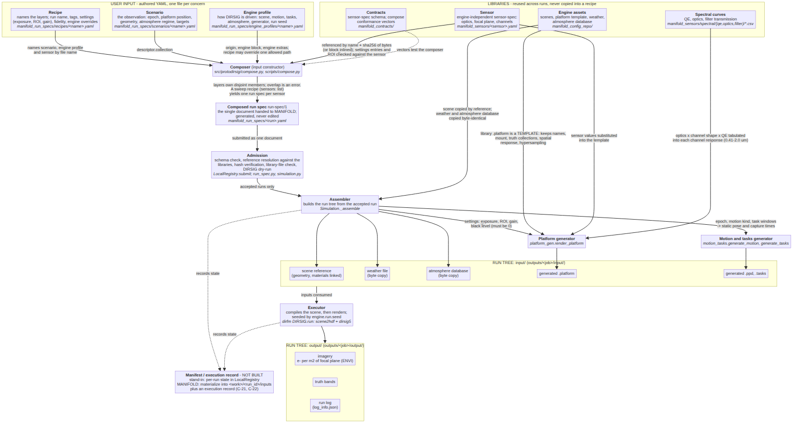
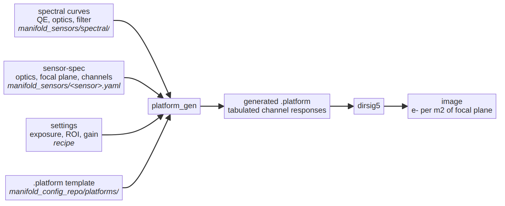
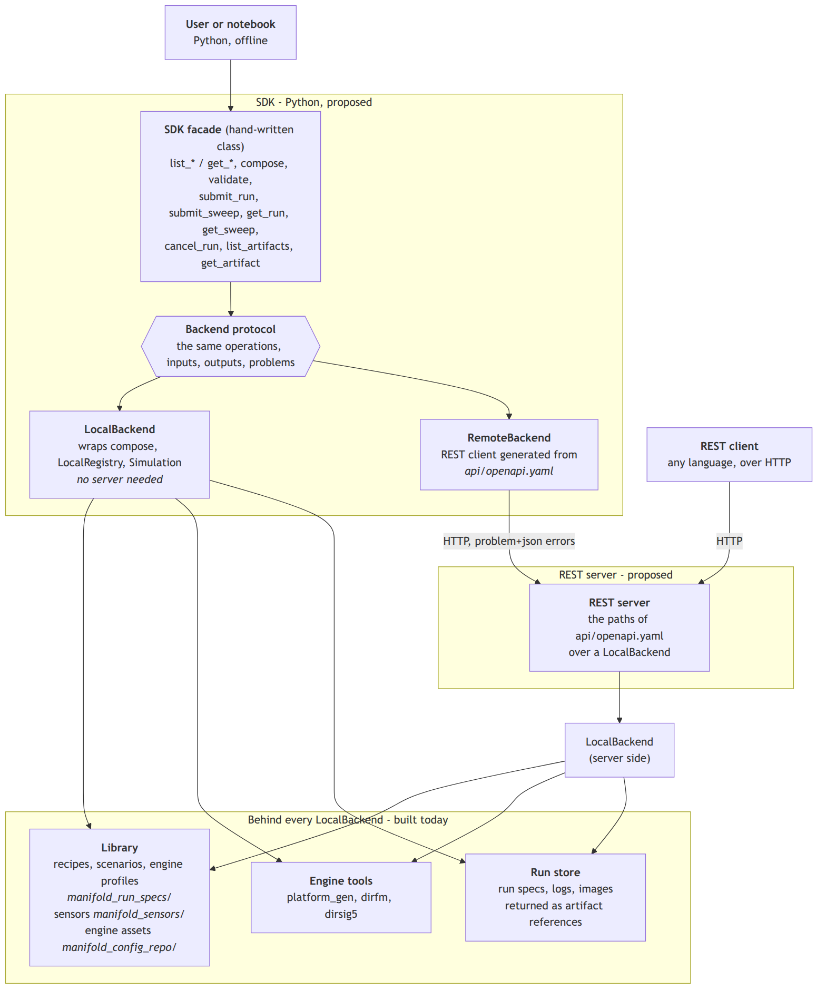

# MANIFOLD–DIRSIG CONOPS and Guide (as built)

**Scope:** the driver for DIRSIG5 jobs from MANIFOLD run specs (`dirfm`, the `manifold.core` and `manifold.sim` packages, notebooks) and the interface it presents to MANIFOLD.

**Status of the document:** a theory of the interface, tested against the code in this repository and periodically against the MANIFOLD implementation team. Section 10 records each disagreement and its outcome.

**Authority:** this document is the single description of what is built. When code and document disagree, the code is right until the document is corrected in the same commit.

**Contents.** Part I, Overview: how a run is built, the sensor path, roles, repository folders, where to start. Part II, Reference: 1 Purpose; 2 System overview; 3 Run-spec contract; 4 `sensor-spec/1`; 5 Repository layout and resolution roots; 6 Using `dirfm`; 7 SDK as built (7.1 SDK API, 7.2 Packaging and naming, 7.3 Engine adapters, 7.4 SatSim adapter); 8 Notebooks; 9 DIRSIG behaviors that matter; 10 Convergence with MANIFOLD; 11 Reproduce from zero.

## Part I. Overview

The `manifold` SDK in this repository is the DIRSIG-side driver of the MANIFOLD synthetic-data path, built without the MANIFOLD registry, executor or orchestrator. A run spec states a collection and a sensor (or, in the pass-through form (`built / proposed`, `tests/test_passthrough.py`), names a demo directory DIRSIG runs as authored); it is composed from layer files (a recipe naming a scenario, an engine profile and a library sensor), and the driver validates it, generates the DIRSIG input files that the spec determines, executes `dirsig5`, and returns imagery with truth. A second engine, SatSim, runs through the same SDK in a pass-through form only (`built / proposed`, section 7.4, `tests/test_satsim_adapter.py`): a library SatSim configuration run as authored, seeded, in SatSim's own interpreter. `Workspace` over a `LocalBackend` (a run store on disk and one worker process per run; section 7) stands in for the registry and executor so the interface to MANIFOLD can be exercised before they exist.

### How a run is built

Each node is a function, in italics its location in the repository; each edge label states what the flow does. `<name>` is a file stem, `<run>` a composed run name, `<job>` a job directory under `outputs/`.



Source: `docs/diagrams/run_workflow.mmd` (SVG beside it).

1. **Author.** Three YAML files state a run. The recipe gives the run's identity, settings, fidelity and its choice of the other layers; the scenario gives the observation (epoch, platform position, geometry, atmosphere regime, targets); the engine profile gives how DIRSIG is driven (scene, motion, tasks, atmosphere, seed). The sensor is not authored per run: the recipe names a file in the sensor library.
2. **Compose.** The composer merges the layers into one `run-spec/1`, the single document MANIFOLD receives. A sweep recipe with a `sensors:` list yields one run spec per sensor.
3. **Admit.** Schema check, reference resolution against the libraries and content-hash verification; a DIRSIG dry run only where it is asked for (`validate` at level `dry_run`, `LocalRegistry.submit`). `Workspace.submit_run` admits without running the engine, and the worker of a layered run performs the dry run before it renders (section 7.1). An admitted run has resolvable inputs.
4. **Assemble.** The assembler builds the input tree: library files copied or linked, the `.platform` rendered from the library template, the sensor and the settings, and the `.ppd` and `.tasks` generated from the motion block, the epoch and the task windows.
5. **Execute.** `dirfm` invokes `scene2hdf` and `dirsig5`. A render with a stated seed is byte-reproducible for the AUROR job; in general a repeat is bit-identical only with one thread, because at DIRSIG's default thread count some scenes accumulate or sample in a different order from run to run (section 9).
6. **Return.** Imagery in electrons per m² of focal plane, truth bands, and the run log in the output tree.

Three rules explain the diagram.

- **Libraries are referenced by name and hash, and read only.** The sensor, the spectral curves, the engine assets and the contracts are read-only. The composed run spec carries a sensor's name and the sha256 of its bytes (or the block inline); a run's job folder holds copies of, or links to, the library files it uses, never the library itself. The library `.platform` is a template: the generator keeps what the specs do not model (names, mount, truth collections, spatial response, hypersampling) and substitutes what they do.
- **Authored layers own disjoint members.** A member in two layers is an error. The composed run spec is never edited by hand.
- **The run tree is derived.** Nothing in `outputs/<job>/` is source. The manifest is not built. Per-run state and the SDK's execution record (`execution.json`) are kept on disk in the run store (section 7), and MANIFOLD's materialization and execution record take their place (C-21, C-22).

### Sensor path



Source: `docs/diagrams/sensor_path.mmd` (SVG beside it).

The sensor description is the single source for modeled sensor values. The library `.platform` supplies only what the specs do not model (names, mount, truth collections, spatial response, hypersampling). Swapping the sensor changes the `sensor` reference and the `entry_id` of each `settings` member; no other sensor value is stated in the run spec.

### Roles

| Role | Today | Future |
|---|---|---|
| Input construction | `compose` (`compose_sweep`), `scripts/compose.py`, `LocalRegistry.submit_recipe`, `submit_sweep` | MANIFOLD input constructor, with `compose` as its reference (C-21) |
| Sweep execution | `LocalRegistry.run_sweep`: per-run state under a sweep id | MANIFOLD orchestration; how a sweep id is recorded is C-22 |
| Registry and admission | `LocalRegistry`, `simulation.schema_errors` (enforcing the `manifold_contracts/` schemas), `identity` (run and sweep ids) | MANIFOLD registry (hashing, extraction, catalog) |
| Executor | `Simulation.run` | MANIFOLD executor; mounts the DIRSIG runtime |
| SDK API | `Workspace` over `LocalBackend` (section 7.1); the contract is `api/` (`sdk-api/1`, `built, partial / internal`: no REST server or `RemoteBackend` yet, `tests/test_local_backend.py`) | `RemoteBackend` and a REST server for users, not for the MANIFOLD executor (phase 3) |
| Generator | `run_spec`, `platform_gen` (`manifold.core`), `motion_tasks` (`manifold.engines.dirsig`) | SDK (`packages/`) |
| Orchestration | notebooks | Dagster (out of scope here) |

### Repository folders and their MANIFOLD counterparts

A `manifold_` prefix marks a folder that maps to a future MANIFOLD repository (`manifold_sensors` and `manifold_run_specs` are provisional names until the MANIFOLD team names those repositories).

| Folder | Holds | Counterpart |
|---|---|---|
| `manifold_config_repo/` | engine assets | MANIFOLD config repository |
| `manifold_sensors/` | sensor-spec library, spectral curves | sensor profile library |
| `manifold_run_specs/` | layer files and the run specs composed from them | registered run specs |
| `manifold_contracts/` | schemas, vocabulary, validators, conformance vectors | `manifold-contracts` |
| `packages/core/`, `packages/sim/`, `packages/engine-dirsig/`, `packages/engine-satsim/` | the SDK as distributions: `eoptic-manifold-core` (`manifold.core`), `eoptic-manifold-sim` (`manifold.sim`) and one per engine, `eoptic-manifold-engine-dirsig` (`manifold.engines.dirsig`, the DIRSIG driver) and `eoptic-manifold-engine-satsim` (`manifold.engines.satsim`, SatSim pass-through, `built / proposed`, `tests/test_satsim_adapter.py`); section 7.2 | SDK |
| `external/`, `scripts/`, `notebooks/`, `tests/`, `outputs/` | tooling | none |

### Where to start

| Diagram stage | Exercised in |
|---|---|
| Composer, composed run spec | `stage_03_sensor_sweep`: the recipe `sensor_sweep_tahoe` through `compose_sweep`. Stages 01 and 02 start from the generated `auror_ref.yaml` and do not compose. |
| Admission | `stage_02_conformance_template` (`LocalRegistry.submit`); `stage_03_sensor_sweep` (`submit_sweep`) |
| Assembler, motion and tasks generator, input tree | `stage_01_auror_from_runspec`: assets resolve in `manifold_config_repo/`, motion and tasks are generated from the spec |
| Platform generator | `stage_03_sensor_sweep`: the curves and the channel response written into each `.platform` |
| Executor, output tree | `stage_01` (render); `stage_02` (render and DIRSIG logs); `stage_03` (three sensors at 32 × 32, GSD from the truth) |
| DIRSIG and `dirfm` without the driver | `dirfm_tutorials/` |
| Manifest | none |

A new user reads `dirfm_tutorials/tutorial_dirfm_basics`, then the stage notebooks in order. Stage 01 shows a run tree built from a run spec, stage 02 shows admission and the logs, and stage 03 shows how a change of sensor reaches the run tree.

Part II is the reference: the contract, the sensor specification, the repository layout, the SDK, the DIRSIG behaviors that matter, and the points of disagreement with the MANIFOLD documents (section 10), with every open decision listed in one place, its owner and whether it blocks the 0.1 release (section 10.1).

## Part II. Reference

Status markers have two axes, stated here once and mirrored in `api/README.md`; `scripts/status_markers.py --check` enforces them in this document, `api/`, `README.md` and `BACKLOG.md`.

<!-- status-legend -->
| Axis | Term | Meaning |
|---|---|---|
| Build | `planned` | No code at HEAD. |
| Build | `built, partial` | Code at HEAD; its limits are stated in the same sentence or row (for a heading, in a "Limits" sentence of its section). |
| Build | `built` | Code at HEAD, with its evidence named in the same sentence, row or section: a test file or test, a conformance suite, or an executed notebook. |
| Agreement | `open` | A question for MANIFOLD; no position taken. |
| Agreement | `proposed` | Offered to MANIFOLD, not agreed. |
| Agreement | `agreed` | Accepted by MANIFOLD: only where the C-n row's Outcome (section 10) is **accepted**. |
| Agreement | `internal` | An SDK-side contract not offered to MANIFOLD: `api/` and section 7.1, the SDK's modules and tooling. |

A marker is one build term and one agreement term, written `build / agreement`: for example `built / proposed`, `planned / proposed`, `built / internal`. `open` alone marks a question with nothing built SDK-side. A table that carries markers has a Build column and an Agreement column (and, where the evidence is not elsewhere in the row, an Evidence column); a Build cell is `—` only for an `open` question with nothing to build.
<!-- /status-legend -->

One item may carry two agreement terms in two documents without contradiction: "internal" describes the status of the document it stands in (in `api/`, the SDK's own contract), "proposed" the offer a C-n row makes to MANIFOLD. So `list_engines`, artifact roles and verdicts are "internal" in `api/` and "proposed" in this document, where C-32 and C-34 offer them.

## 1. Purpose

The SDK takes a `run-spec/1` YAML and executes the run it describes through `dirfm`, with no MANIFOLD executor, registry, or orchestrator. Its purposes are: (a) establish which parts of a `dirsig-engine/1` run spec a real job can be driven from; (b) validate and integrate `dirfm`; (c) grow an abstraction layer into the SDK (now the `manifold.core` and `manifold.sim` packages); (d) provide notebooks for new `dirfm` and SDK users; (e) test the MANIFOLD requirements by conforming to them. The reference job is the AUROR static NIR pass over DIRSIG's Tahoe scene, `manifold_run_specs/auror_ref.yaml`.

## 2. System overview

Layers, bottom to top:

- **DIRSIG5** (`dirsig-2026.38.0.a020954`): `scene2hdf` and `dirsig5` binaries. Inputs are files; the scene is consumed by path.
- **`dirfm`** (RIT, read-only dependency): Python builders for DIRSIG input files, and `DIRSIG.run()`, which constructs the `dirsig5` command line of every layered run; a pass-through run (`built / proposed`, `tests/test_passthrough.py`) is the one exception: `passthrough.run_engine` runs `scene2hdf` and `dirsig5` on the demo's own simulation file.
- **`manifold.core`, `manifold.sim` and `manifold.engines.dirsig`** (`packages/core`, `packages/sim`, `packages/engine-dirsig`): the engine-neutral run-spec layer and the engine adapter protocol; the run store, worker, engine discovery and `Workspace`; and, in the DIRSIG engine distribution, the gap-fillers and the run-spec driver (section 7).
- **Notebooks**: stage notebooks (the conformance template), `dirfm` tutorials, sidebars (section 8).

A recipe is composed into a run spec (`compose`, section 3.5); a composition error names the layer file and field. A run spec then becomes a run in three steps, each independently testable (hash verification and `.platform` rendering sit in steps 2 and 3):

1. **Schema check** (`simulation.schema_errors`): the run spec conforms to `run-spec/1` and `dirsig-engine/1`, enforced from `manifold_contracts/run-spec-1.schema.json` and `dirsig-engine-1.schema.json` (section 3).
2. **Resolution** (`run_spec.resolve_run`, returning a `ResolvedRun`): `engine.*` becomes `dirfm` objects and file paths.
3. **Execution check** (`Simulation.validate`): the job is assembled in a scratch directory and run with `dirsig5 --dry_run --log_info_filename`.

`LocalRegistry.submit` runs the three and accepts or rejects; `submit_recipe` composes first. Submission also refuses a run spec with an unstamped reference, a `content_hash` that is still the `sha256:<hash>` placeholder (`run_spec.unstamped_refs`), because its run id would not identify the inputs; `Simulation.validate` reports such references (`ConformanceResult.unstamped`) without failing, since the placeholder is the authoring state. A rejection is one problem details object (RFC 9457) that names the layer file and the field in it where an authored file is at fault (`SubmissionResult.problem`, `manifold.core.problems`). `Simulation.run` does not check acceptance: it renders any run that resolved, so a caller renders only a run `LocalRegistry.submit` accepted; `run_sweep` renders only the accepted runs of a sweep.

**Resolved versus generated** `built / proposed` (`tests/test_run_spec.py`, `tests/test_motion_tasks.py`). Each `engine.*` block is one or the other.

- *Resolved*: the block names an existing file and the spec selects it by reference. `scenes`, `atmosphere.database`, `weather.file`: nothing is built from spec values. `platform` is resolved the same way but names a template, from which the job's `.platform` is generated (below), or, with `as_authored`, the file copied into the job as it is.
- *Generated*: the block, or the sensor description it references, states values from which a file is built at job-assembly time. `motion` (`.ppd`), `tasks` (`.tasks`), the `.platform` (copied instead with `as_authored`) and, with `atmosphere.uniform` or `atmosphere.simple`, the `.atm`; `working_folder` files are copied. Motion and tasks use `dirfm.platform_motion.PlatformPosition`, `dirfm.FlexMotion` and `dirfm.tasks.TASKS` and are `built, partial / proposed`: `motion.kind: static` (a `.ppd`) with a `scene`-frame position and Euler orientation in `sceneenu`, and `motion.kind: orbit` (a TLE propagated to ECEF waypoints and written as a FlexMotion `.motion` with a LookAt orientation, section 3.2) (`tests/test_motion_tasks.py`, `tests/test_orbit_motion.py`); `waypoints` (authored samples) is not built and is rejected at resolution. The `.platform` is rendered from the library template by `platform_gen` (section 4); `engine.platform` still names the template.

Generation happens where `Simulation._assemble()` copies resolved assets into the job's `input/` directory. The closest MANIFOLD analog is `materialize` into `<work>/<run_id>/inputs` (Configuration_v02, line 309).

`resolve_run` is narrow by design (`built, partial / internal`, `tests/test_run_spec.py`, `tests/test_orbit_motion.py`): `new_atmosphere` with ephemeris `spice` and weather `library`, or `basic` with `uniform` or `simple` (section 3.2), one scene, one sensor entry with one focal plane, and motion `static` (scene-frame position, Euler orientation in `sceneenu`) or `orbit` (propagator `skyfield_sgp4`, a window covering every task window in whole waypoint steps, LookAt at a `sceneenu` target with `up: along_track`, a scene with a geodetic origin). It raises `RunSpecError` on anything else (among them motion `waypoints`, the `four_curve` atmosphere, `basic` with a file, `split_channels: true` with `new_atmosphere`), so what it accepts is a lower bound on what the schema permits. A pass-through run is resolved by `resolve_passthrough` instead (section 3.2).

## 3. Run-spec contract `built, partial / proposed`

A run spec is one YAML document with three keys (Metadata_v02 §6.3).

| Key | Required | Content |
|---|---|---|
| `spec_version` | yes | `run-spec/<major>`; currently `run-spec/1`. |
| `descriptor` | yes | Engine-independent. Governed vocabulary, units, frames, provenance. Authority for catalog search. |
| `engine` | no | Origin-specific generator input; one schema per origin (`dirsig-engine/1`). Absent for field data. Not indexed. |

`descriptor` is registered, searched, and hashed into the provenance record. `engine` is what the generator and executor consume.

Limits: the schemas admit more than the DIRSIG driver resolves (`resolve_run`, section 2); the forms section 3.2 names as refused are refused at resolution.

**Schemas** `built / internal`. `manifold_contracts/run-spec-1.schema.json` (the whole run spec, the engine block an open object; `built / proposed`, C-29) and `manifold_contracts/dirsig-engine-1.schema.json` (the DIRSIG engine block, including the `new_atmosphere` and `orbit` forms and the pass-through mode, `built / proposed`) state this section as JSON Schema 2020-12. They are the SDK's reading of the MANIFOLD documents, not offered to MANIFOLD (the status-marker note in Part II). Admission enforces them: `simulation.schema_errors`, the schema check of `Simulation.validate` and `LocalRegistry.submit`, is `contract.schema_violations` (each violation as a JSON Pointer into the spec: the run-spec schema, then the engine block against the schema of the adapter registered for `descriptor.origin.engine`, section 7.3) followed by `semantic_errors`, the rules JSON Schema cannot express (an engine id no registered adapter serves, named with the registered engines; an opaque descriptor without the pass-through engine mode, or the reverse; and the adapter's own rules, for DIRSIG an integer member written as a float). `tests/test_run_spec_schema.py` validates every composed run spec against the schemas (the DIRSIG engine block against `dirsig-engine-1`, as the registry selects it), rejects a corpus of mutations, and checks that the checker accepts nothing the schemas reject. What JSON Schema cannot express (content hashes, `entry_id` resolution, black level 0, the orbit window rules, the refusal of placeholder hashes at submission) is enforced at admission; `manifold_contracts/README.md` lists it. The build copies the schemas into the package (`manifold/core/_contracts/`), so an installed library validates without the repository; `manifold_contracts/` keeps the one tracked copy. Members neither this document nor any run defines are left open in the schemas: `collection.platform`, `field`, `settings[].binning`, and in the engine block `motion` kind `waypoints`, the `four_curve` atmosphere, `basic` without `uniform` or `simple`, and `weather.source: install`.

**Run ids** `built / proposed` (`tests/test_identity.py`). A run id is the sha256, 64 lowercase hex digits, of the RFC 8785 canonical JSON serialization of the resolved run spec: the parsed document with its sensor reference replaced by the referenced sensor-spec's `sensor` block, after a stamped hash is verified (a pass-through spec has an opaque descriptor and no sensor, so its resolved spec is the parsed document, which names the directory's digest and the simulation path). Each settings value's `provenance` label is part of the document and is hashed; the generated file's header and the composition provenance are not part of the parsed document and are not. The same spec with its sensor inline or by reference has one id. A sweep id is the sha256 of the canonical JSON of the sorted list of its run ids. The SDK computes both (`manifold.core.identity`; `ComposedSweep.run_ids` and `sweep_id`, `SubmissionResult.run_id`, `SweepResult.sweep_id`); `manifold_contracts/vectors/identity/` holds the conformance vectors. A run id covers each referenced file through its stamped `content_hash`, a scene through the `dirhash/1` digest of its directory (section 3.2); submission refuses a placeholder, so the id of a submitted run covers every input it references (C-23).

### 3.1 `descriptor`

Required blocks for `run-spec/1`: `meta`, `origin`, `collection`, `sensor`, `settings`, `fidelity`; an opaque descriptor (`built / proposed`, the pass-through form, section 3.2, `tests/test_passthrough.py`) carries `meta`, `origin`, `fidelity` and `opaque` instead, with no `collection`, `sensor` or `settings` (C-25). `field` is required iff `origin.kind: field`. `extras` is optional. Unknown keys are rejected everywhere except `extras` and the members the schemas leave open (`collection.platform`, `field`, `settings[].binning`; section 3).

- **`meta` / `origin`.** `meta.name` is an immutable alias to one `parameter_set_id`. `origin` has two axes, `kind` (`synthetic`, `field`) and `engine` (an engine id such as `dirsig`, `satsim` or `usd`, or `field`; an open identifier in the published schema, `built / proposed` (C-29, `tests/test_run_spec_schema.py`), and admitted only when a registered adapter serves it); `engine: field` iff `kind: field`. DIRSIG: `origin: {kind: synthetic, engine: dirsig}`.
- **`collection`.** Observation conditions as governed terms and derived quantities, not engine parameters. `atmosphere.regime` is a vocabulary term, not a DIRSIG preset. `epoch` is phenomenon time (read from `.tasks`). `geometry.range` is required when `targets` is non-empty.
- **`sensor`.** A `sensor-spec/1` reference, or the sensor-spec's `sensor` block in place; structure per `AV_MANIFOLD_Detector_v02` (section 4).
- **`settings`.** Commanded per-entry values: exposure, frame rate, gain, black level, ROI, binning. One member per run (C-19), naming the `sensor.entries[]` entry the run models; `entry_id` must resolve. Stays in the run spec, not the sensor file.
- **`fidelity`.** `modeled`, `approximated`, `absent` lists and free-text `valid_for`. Authored, not derived, not queryable.
- **`extras`.** Namespaced `<origin>.<name>`; stored as `jsonb`; no query guarantees.
- **Quantities.** A `quantity` is `{value, provenance, uncertainty?, uncertainty_kind?, conditions?}`. `provenance` is `measured`, `specified`, `modeled`, or `inherited_from_type`; `conditions` is required when `measured`. Fields fixed by design are plain scalars.

### 3.2 `engine` (`dirsig-engine/1`)

The `engine` section is origin-specific: one schema per engine, supplied by the engine adapter registered for `descriptor.origin.engine` and applied at admission (`built / proposed`, section 7.3, `tests/test_engine_set.py`; the published `run-spec-1.schema.json` leaves the engine block an open object and the engine id open, C-29). DIRSIG (`dirsig-engine/1`) is the first engine implemented. SatSim (`satsim-engine/1`, `built / proposed`, pass-through form only, `tests/test_satsim_adapter.py`) is the second, section 7.4; `docs/SatSim_probe.md` records its install, CPU cost, outputs, side effects, repeatability and how its configuration maps onto the descriptor. Others (`usd`) will follow with their own `<engine>-engine/<major>` schemas; none of what follows constrains them. The `descriptor` is the engine-independent part of the contract and is shared across all engines. This document describes the DIRSIG engine only.

Members (Configuration_v02 A.8.1): `generator`, `scenes`, `platform`, `motion`, `tasks`, `atmosphere` (required); `weather`, `ephemeris`, `run` (optional), and `working_folder` (optional, `built / proposed`, below). The pass-through mode (`built / proposed`, `tests/test_passthrough.py`) replaces these with `generator`, `mode`, `passthrough` and an optional `run` (below, C-26). The schema is `manifold_contracts/dirsig-engine-1.schema.json` (`built / proposed`, `tests/test_run_spec_schema.py`).

- **Division with `descriptor`.** Epoch, exposure, frame rate, gain, and black level are stated once, in `descriptor`; the generator writes them into `.tasks` and `.platform`. Platform position at epoch is emitted by the generator and may be omitted from an authored spec.
- **`scenes[]`.** Library scene references with optional `[x,y,z]` offsets. `scene2hdf` compiles the HDF at run time beside the `.scene` file; the HDF is derived, outside the manifest, never pre-compiled in the library. A scene reference names the `.scene` file but stands for its directory (`scenes/<scene>/`, with `geometry/`, `materials/` and `maps/`), so its `content_hash` is the `dirhash/1` digest of that directory: the sha256 of a sorted manifest of every file's sha256 and relative path, defined in `manifold_contracts/README.md` (`manifold.core.dirhash`). `scripts/stamp_hashes.py` stamps it and resolution verifies it; a validate run leaves it unchanged, since the job compiles a copy of the `.scene` file. Beside that copy the job links `geometry/`, `materials/` and `maps/`, links every other folder the `.scene` names inside its own folder, and copies (not links, since `scene2hdf` writes beside the `.scene`) the files it names there, one level into a named `.glist` or `.odb` (`built / internal`, `tests/test_scene_siblings.py`: a demo such as PointCollectors2 names its geometry list and material file beside its `.scene`); the library's Tahoe scene names none, so the jobs of earlier runs are unchanged, and no run id depends on the job folder.
- **`platform`.** References a library `.platform` by name and hash; the file is a template. The generator (`platform_gen`) substitutes every value `descriptor.sensor` and `descriptor.settings` model (section 4) and keeps the rest: names, mount, truth collections, spatial response, hypersampling, bandpass. `output_prefix`, `split_channels`, `integration_samples`, and `channel_response`: `tabulated` (default) writes each channel as a tabulated response; `native` reproduces the received platform's DIRSIG gaussian channel (section 9) and is used only by `auror_ref.yaml`. `split_channels: true` with `new_atmosphere` is refused at resolution: it asks for one spectral state per channel, which the database does not hold (section 9).
- **`platform.as_authored`** `built / proposed` (C-40, `tests/test_authored_platform.py`). `true`: the ref is the job's `.platform` as authored (a DIRSIG demo's, for example), copied into the job byte for byte and covered by its stamped content hash, so it is in the run id as an asset; it is not rendered from the sensor-spec. `descriptor.sensor` and `settings` are then still loaded and checked but not applied (the image is in whatever units the file states, a demo's usually `watts` per `cm2`, not `platform_gen`'s electron exposure), and `integration_samples` and `channel_response` are refused with the reason. The library-file check parses the file as a `<platform>` with a focal plane; DIRSIG's dry run reads the rest. A camera that captures several frames in one task window (an external clock with several trigger times, Thermal2; several focal planes, Polarization4) passes DIRSIG's dry run but is refused by the SDK's check of the dry-run log, which expects one capture per task window (C-43, `Simulation._check_log`; measured, not changed). Chosen over a sensor-spec holding a demo camera's values (BACKLOG): it needs no change to `platform_gen` or to `sensor-spec/1`, and it commits no value of a licensed demo file (section 5.1). A run that does not state it keeps its id.
- **`working_folder`** `built / proposed` (C-42, `tests/test_working_folder.py`). The files DIRSIG looks for in the working folder, the folder it runs in: a demo's folder when the demo runs as authored, the job's input folder in the layered form. Measured (`docs/DIRSIG_layered_comparison.md`): a file the platform names in a `<filename>` by a relative name (BayerPattern1's `pixels.hdf`; DIRSIG does not look beside the platform file), and a geometry list the `.scene` names by a bare name that lies beside it and not in its `gdbdirectory`, with the files that list names beside it (Telecentricity1's `demo.glist` and `Sphere.obj`; DIRSIG looks in the working folder and the `gdbdirectory` only), and a file the scene's material file names in a `PARAMETER_FILE`, `BRDF_FIT_FILE`, `EMISSIVITY_FILE` or `BUNDLE_FILENAME` entry by a relative name that lies relative to the scene's folder and not to its `emsdirectory` (Polarization5's `./materials/*.brdf`, `grass.fit` and `grass.ems`; DIRSIG looks in the working folder and the `emsdirectory` only), or with an empty `emsdirectory` (BundledMaterials1's `bundles/*.mat.hdf`; the working folder only), and a file the material file names in an `EMISSIVITY_PROP` `FILENAME`, a `TEMP_SOLVER` `IMAGE_FILENAME` (with the image's ENVI header, `<name>.hdr` or `<stem>.hdr`), a texture `IMAGE` `FILENAME` or a `MATERIAL_MAP` `IMAGE_FILENAME` by a relative name that lies relative to the scene's folder, where the job's scene copy does not hold it in the entry's folder, the `emsdirectory` or the `mapdirectory` (MappedTherm1's `roof_metal_gray.ems`, `values.img` and `values.img.hdr` beside its `.scene`; ChipMaker2's `materials/*.ems`, `maps/texture.png` and `maps/material.png`; DIRSIG looks in the working folder and that folder only, measured by dry runs), and a file the material file names in a `TEMP_SOLVER` `FILENAME` or a `SOURCE_SHAPE` by a relative name that lies relative to the scene's folder, where the scene copy does not hold it in any folder DIRSIG searches for that key (Fireball1's `fireball_temp.txt`: the working folder and the scene's seven directory elements, `emsdirectory` to `mapdirectory`, not the scene's own folder; IESSources1's `example1.ies` to `example3.ies`: the working folder and the `srcdirectory`; measured by dry runs; DataDrivenTempSolver1's `TEMP_SOLVER` `FILENAME`s lie in a linked folder under one of those directories and need nothing). The loader finds them from the scene, its material file and the platform file (`scene_ref.working_folder_files`) and requires `working_folder` to list exactly those, each as `{name, ref: {name, content_hash}}` (its name in the working folder and its library ref), so their bytes are in the run id; a missing, mismatched or unneeded entry is refused at resolution, naming the entry, and the pass-through form, which runs in the demo's own folder, may not state it. The job copies each file into its input folder (copies, not links). The library's scenes and platforms need none, so no existing run states it and every existing run id and job is unchanged. Not followed: other material-file keys (unmeasured, such as a `REFLECTANCE_PROP` `IMAGE_FILENAME`, `SLI_FILENAME`, `TXT_FILENAME` and `DATA_FILENAME`). Stated in the engine block rather than in `resources.assets` (section 3.3): an adapter resolves the engine block and the descriptor only, so a requirement on `resources` could not be checked at admission without changing the adapter protocol.
- **`motion`.** `static | waypoints | orbit`. `static` (a `.ppd`) and `orbit` (`built / proposed`, below, `tests/test_orbit_motion.py`) are generated; `waypoints` is refused at resolution. Orbit propagation (skyfield + SGP4 with UT1–UTC) runs outside DIRSIG; only ECEF waypoint samples cross into the engine body.
- **`tasks`.** `{start, stop}` windows relative to `descriptor.collection.epoch`; `start == stop` is one static sample.
- **`atmosphere`, `weather`, `ephemeris`.** `atmosphere.plugin` is `four_curve` or `basic` in A.8.7. AUROR uses `new_atmosphere` (`built / proposed`, section 10, `tests/test_run_spec.py`). `ephemeris.plugin: spice` takes no inputs and reads kernels from the DIRSIG installation.
- **`atmosphere.uniform`** `built / proposed` (C-39, `tests/test_uniform_atmosphere.py`). With `plugin: basic`, `uniform` states a BasicAtmosphere `.atm` that the generator writes into the job (`basic_atmosphere`): `radiative_transfer` (DIRSIG's UniformAtm: `hemisphere_irradiance`, spectrally constant, and `sky_fraction`, its diffuse share), `weather.install_file` (a weather file of the DIRSIG installation, written as `$DIRSIG_HOME/lib/data/weather/<name>`; the demos use `mls.wth`) and, optionally, `fixed_ephemeris` (`units`, `solar_zenith`, `solar_azimuth`). Such a run names no library weather file (`weather` absent or `source: install`), and with `fixed_ephemeris` no `ephemeris`: DIRSIG replaces the `.atm`'s fixed Sun with a SpiceEphemeris plugin when the job has one (section 9). A `uniform` block without `weather` is refused at resolution, with the reason (DIRSIG refuses a `.atm` without uniform weather). Not written: turbulence, lunar values, metadata, and the classic radiative-transfer form. The run id covers the stated values; a run that does not state `uniform` keeps its id.

- **`atmosphere.simple`** `built / proposed` (C-41, `tests/test_simple_atmosphere.py`). With `plugin: basic`, `simple` states the same `.atm` with DIRSIG's SimpleAtm in place of UniformAtm: `radiative_transfer.apparent_sky_temperature` (kelvin, measured: in an 8 to 12 um render of DataDrivenTempSolver1 the pixels that see the sky hold the band-integrated Planck radiance at the stated value in kelvin to a relative 2e-5, at three values, `docs/DIRSIG_layered_comparison.md`; it drives the thermal sky irradiance, the visible sky irradiance is 0 and the Sun a scaled 5,800 K blackbody), and the same `weather.install_file` and optional `fixed_ephemeris` as `uniform`, under the same rules (no library weather, no `ephemeris` beside a fixed Sun, refused without `weather`). `simple` and `uniform` exclude each other (the schema and the loader refuse both). The job's file is `simple.atm`, written by `basic_atmosphere.write_simple_atm`. Not written: turbulence, lunar values, metadata. The run id covers the stated values; a run that does not state `simple` keeps its id.
- **`run`.** The seed, the one member `dirsig-engine/1` gives `engine.run` (convergence settings are not modelled). It is part of the run spec, so a changed seed is a new run id (`test_differences_that_change_the_id`). `engine.run.seed` is confirmed to work: `dirfm.DIRSIG.set_seed` passes `--random_seed` to both `scene2hdf` and `dirsig5`, and seeded renders of the AUROR job are byte-identical across assemblies. `--threads` is not in `engine.run`: a run requests a thread count in `resources.cpu_threads` (section 3.3), which enters the run id and which the worker passes to `dirsig5` as `--threads`; at the default thread count a seeded repeat of some demo scenes differs, and one thread makes it identical (section 9; C-08, C-28).
- **Not in the body** (A.7): quaternion orientation, STK report import, velocity-tracking `up`, `EarthGrid`, jitter, classic radiative transfer, turbulence (uniform and simple radiative transfer with uniform weather are in it as `atmosphere.uniform` and `atmosphere.simple`, above). A tree needing these is registered with a hand-written descriptor.

#### `motion` kind `orbit` `built / proposed`

A moving platform on an orbit, stated as the law that produces its track, not as DIRSIG's classes. Members of `engine.motion`: `kind: orbit`; `orbit.tle` (a library ref `{name, content_hash}` under `orbit/`, section 5); `orbit.propagator` (`skyfield_sgp4`, the only value); `orbit.earth_orientation` (a library ref to the UT1–UTC tables, `orbit/iers.npz`); `orbit.window` (`start` and `duration`, seconds from `descriptor.collection.epoch`, which must cover every task window); `orbit.waypoint_spacing` (seconds; the window must be a whole number of steps); and `orientation: {kind: lookat, lookat: {frame: sceneenu, target: [x, y, z], up: along_track}}`. The generator (`motion_tasks.generate_motion`) propagates the TLE over the window at a tenth of the spacing, thins the track to ECEF waypoints at the spacing, and writes a DIRSIG FlexMotion `.motion` (waypoints location engine in `ecef`, LookAt orientation engine at the scene ENU target). `up: along_track` is the horizontal velocity direction at the window centre, held fixed for the pass (`orbit.along_track_up`). `PlatformFilesPlugin` passes the `.motion` file to DIRSIG as it passes a `.ppd`.

Everything the form reads is a hashed library file: the TLE and the Earth-orientation tables (a byte copy of the tables bundled with skyfield 1.54, daily UT1–UTC from 1973 to January 2027, no polar motion). The JPL ephemeris used to choose a pass (`de421.bsp`, for the sun's elevation) is an authoring-time input of this form only and is never one of its run inputs (SatSim declares the same file as a run asset, section 7.4). The propagator's name and versions (`orbit.propagator_provenance()`) are recorded on the run's result for the execution record, never in the run spec. A replacement propagator must reproduce the golden vector in `manifold_contracts/vectors/orbit/` within its tolerance (0.1 m). DIRSIG's own `sgp4` location engine is not used: it applies no UT1–UTC and lands about 33 m from this track.

Space-to-space imaging (an orbital target, the Earth or space behind it) is audited axis by axis, with what is measured and what the existing members cannot express, in `docs/Space_to_space_characterization.md`. Its first scenario family is generated by `scripts/s2s_scenarios.py` from existing members only: static and orbit poses about Lambertian plates in a generated library scene (`scenes/s2s_targets/`), with the exposure, a fixed Sun and the object class as the other axes (`manifold_run_specs/s2s/`, `tests/test_s2s_scenarios.py`). A second family (`s2s2-*`, scene `scenes/s2s_blur/`) adds shutter blur: a resolved plate and an unresolved plate moving against a barred background, with platform motion expressed as scene motion. It also adds look angle against that background, and the `orbit` form tracking a plate. A third family (`s2s3-*`, scene `scenes/s2s_sun/`) varies the Sun and the phase angle on DIRSIG's analytic sphere primitive, hyperresolved and unresolved, against the Lambertian sphere's phase function, and the Sun's zenith against a barred background. The measurements are in the same document. Since round 32 they are rerun by `scripts/s2s_measure.py` (it reads a completed run or renders the spec at one thread, reduces the product, and writes one record per run to `docs/data/s2s_results.jsonl`; `--check` recomputes every expected value from the specs), and `tests/test_s2s_results.py` asserts the closed-form cases against those records with tolerances taken from the measured residuals.

A multi-frame pass needs a platform template whose image and truth files are written once per capture (`<schedule>capture</schedule>`, files `<base>-t<task>-c<capture>.img`); with the `simulation` schedule DIRSIG stacks the frames in one image and keeps only the last frame's truth. `Simulation.run` returns every capture as `RunResult.frames`. The descriptor is unchanged: no key is added for the pass, and derived time-varying geometry (range and elevation extremes, closest approach, ground-track extent) is not computed into it (C-05).

#### Pass-through form `built / proposed`

A run spec may name a library directory that DIRSIG runs as authored, instead of the layered engine block. The engine block is then `{generator, mode: passthrough, passthrough: {directory: {name, content_hash}, simulation}, run}`: `directory` is a library ref under `manifold_config_repo/` hashed as a directory (`dirhash/1`), `simulation` the `.sim` or `.jsim` file inside it, and the block carries no scene, platform, motion, tasks, atmosphere, weather or ephemeris. Because collection, sensor and settings cannot be derived from a directory run as authored, the descriptor is opaque: `meta`, `origin`, `fidelity` and `opaque: {source: passthrough}`, with no `collection`, `sensor` or `settings` (C-25). The schemas gain these members additively behind a condition, so every document valid before stays valid and no version changes (C-26). Identity follows the existing rule: the run id is the hash of the resolved spec, which includes the directory's digest and the simulation path (vector `manifold_contracts/vectors/identity/passthrough/`). Admission refuses a missing directory, a stamped digest that does not match, a directory holding a symbolic link or another non-regular file, and a simulation path that escapes the directory or names no file, each naming the field (`manifold.engines.dirsig.passthrough.resolve_passthrough`); an unstamped digest is listed by validation and refused by submission. A recipe of the form `passthrough` (directory ref and simulation file) composes with an engine profile that holds runtime members only (`generator`, `run`); layer ownership stays disjoint. The `dry_run` level of `validate` runs `dirsig5 --dry_run` on a copy of the directory. `scripts/stamp_hashes.py` stamps and checks the directory digest. Execution: the worker compiles each scene the simulation file names with `scene2hdf` (DIRSIG5 reads a compiled scene and does not compile it; a reference to `<name>.scene.hdf` stands for `<name>.scene`), then runs `dirsig5` on a copy of the directory inside the run directory (`<run>/input/<Name>/`; the engine may write beside the simulation file, for example a compiled scene, and the library is never written), with `--output_folder <run>/output` and `HOME` set to a per-run home `<run>/home` (section 5); files the engine writes into the copy instead are moved into `output/`. Every file in `output/` is an artifact (sha256, media type by extension, `application/octet-stream` when unknown, `file://` URI); there are no frames. The execution record gains `mode: passthrough`, the engine's path and version, the `scene2hdf` path and version (each as the tool prints it), the engine's exit status and command, the cache state of the per-run home, the maximum CPU temperature seen while the tools ran (null when the host has no thermal sensors), the cores' current frequency sampled with it (`cpu_freq_khz`: minimum and maximum `scaling_cur_freq` and the largest `cpuinfo_max_freq`; null when unavailable), and a `throttle_suspect` flag, set at 90 C or above with a core below 90 percent of `cpuinfo_max_freq` (the temperature alone when the frequency is unknown). The repository's pass-through recipes are `demo_brdf1_passthrough` and `demo_pointcollectors2_passthrough`, over the demo directories `demo_dirs/Brdf1` and `demo_dirs/PointCollectors2` (section 5.1). `scripts/run_demo.py` runs one through `Workspace` and records wall time, output digests, run-directory size, engine exit status and determinism in `docs/DIRSIG_demo_reference_runs.md`: PointCollectors2 rendered in about 6 s and repeated with identical digests; the Brdf1 recipe names `demo.sim`, which rendered through `Workspace` in 217.3 s and repeated in 209.2 s with identical digests, equal to the demo sweep's for `demo.sim`; Brdf1's `demo.jsim` fails because the NewAtmosphere database it names is not in the demo archive (the recipe named it until the demo sweep found `demo.sim` renders). Both reference runs were repeated after the package rename and gave the run ids and output digests recorded before it.

What the form gives: a content-addressed identity for a demo run as authored (the run id covers the directory's bytes and the simulation path), admission with field-level refusals, the run store, asynchronous execution, cancel, the execution record and artifact references with digests, so a demo's own output is a reference that a layered re-expression can be compared against. What it does not give: parameterization (nothing in the directory can be varied from the run spec; a changed value is a changed directory and a new run id), sweeps (one directory and one simulation file per run), frames (outputs are listed as written, with no per-capture index), and an indexed descriptor (C-25).

**Demo sweep.** `scripts/sweep_demos.py` ran every DIRSIG 5 demo of the installation through this form once, unattended, with ad hoc run specs (no recipes): of 148 attempted, 131 rendered, 16 failed and 1 hit the 1800 s cap; 3 were not attempted (DIRSIG 4 only) and one name is a copy. The failures name atmosphere databases the archives do not ship (NewAtmosphere HDF and ClassicAtm files), DIRSIG 4 features DIRSIG 5 refuses (SAR reflectivity, a scripted mount, an `<atmospherics>` geometry), an external tool (MUSES) and an environment variable (`DIRSIG_ODB`). With DIRSIG's default seed, 82 of 125 repeated demos gave identical outputs. 95 of the 109 demos the coverage survey marks `ready` (67) or `near` (42) now have a pass-through reference to compare a layered re-expression against. The report, with each demo's outcome, cost, output digests and the analysis, is `docs/DIRSIG_demo_sweep.md`, and every attempt's output digests are in `docs/data/demo_sweep_digests.jsonl.gz`; `docs/DIRSIG_demo_coverage.md` tags the demos of interest with their outcome, and `docs/DIRSIG_tagged_demo_features.md` reads those 18 demos feature by feature against the layered form and ranks the loader gaps between them and a layered run (BasicAtmosphere `.atm` with uniform weather and a demo platform form first; first targets Indoors1 for URSO and MoonSat2 for SDA; `BACKLOG.md`). Built since: `atmosphere.uniform`, `atmosphere.simple`, `platform.as_authored` and `working_folder` (section 3.2); Indoors1 renders layered.

**Determinism probe.** `scripts/probe_determinism.py` rendered six demos whose sweep repeats differed (two in radiance, two in truth images only, two in data-recorder text only) twice each at DIRSIG's defaults, with one thread and with a stated seed, and `scripts/compare_outputs.py` classified every difference; it also repeated the three long SDA demos the sweep could not. One thread made every repeat's radiance bit-identical; a stated seed did not; the default seed is fixed; truth-only differences are a renumbering of the optical-property index band, in every condition; recorder differences are a time stamp; Ssa1 repeats exactly in renders about 12 hours apart. The recommendation for comparing a layered run with its reference (exact at one thread or for a deterministic reference, label-aware for truth images, statistical against the default-thread noise floor otherwise) and every measurement are in `docs/DIRSIG_determinism.md`; lidar outputs were run and not analyzed.

**Layered against pass-through.** `scripts/compare_layered.py` expresses a demo in the layered form from its own files (scene and platform by reference with `platform.as_authored`, the `.atm` as `atmosphere.uniform` or `atmosphere.simple`, a static pose and the task windows), renders it and the pass-through form at the same seed and without one, at the demo's native size and outside the repository, and compares the images (`docs/DIRSIG_layered_comparison.md`, `tests/test_compare_layered.py`). The derived layers hold the demo's licensed values, so they are written only in the script's work folder, never committed as recipes. First results: MaterialMap1's layered render is byte-identical to the same-seed pass-through render (image and truth); DensityMap1's differs by sampling noise around equal means, and only because dirfm's `PlatformPosition` writes Euler angles to six decimals (the job re-rendered with the demo's `.ppd`, or with the two angles restored, gives the pass-through digests); PointCollectors2's layered run first failed because its `.scene` names files beside it that the scene reference did not place; with those files copied into the job (section 3.2, `scenes[]`), its layered render is byte-identical to the same-seed pass-through render (image and truth). Second round, the next eight `ready` demos by reference cost: ColorFilterArray1, LensDistortion1 and ReflectanceMap1 byte-identical to the same-seed pass-through render (image and truth); PolyFill1, PrimitiveObjects1 and Indoors1 off by the same six-decimal Euler angles (restoring the angles alone gives the pass-through digests); BayerPattern1 and Telecentricity1 stopped in the dry run, because DIRSIG looks in the working folder for a file the platform names (`pixels.hdf`) and for a geometry list named by a bare name beside the `.scene` and not in its `gdbdirectory`, and a layered job's working folder is not the demo's folder. With `working_folder` built (section 3.2), both layered renders are byte-identical to the same-seed pass-through ones (image and truth); Polarization5, which the same platform rule covers, then stops on files its material file names (`./materials/*.brdf`, `./materials/grass.fit`, `./materials/grass.ems`), which DIRSIG also looks for in the working folder. Fourth round, the next ten `ready` demos by reference cost: GenericMotion1, TemporalIntegration1 and InstanceOptions1 byte-identical; DecalMap1 and VertexNormals1 off by the six-decimal Euler angles; BumpMap2 and DataDrivenArray2 off by dirfm's explicit zero scene offset (`"offset": "0,0,0"` in the jsim; removing it alone gives the pass-through digests, differences below 1e-8); two thermal (8 to 12 um) demos, Balfour2 and DataDrivenTempSolver1, off by the epoch's written form (the `.tasks` reference time in UTC instead of the demo's offset: the same instant, and Balfour2's render equals the pass-through one with only that string restored; DataDrivenTempSolver1's with it and the Euler angles); BundledMaterials1 stopped on material bundles its material file names, which DIRSIG looks for in the working folder only. With `working_folder` extended to those material-file entries (section 3.2), BundledMaterials1's layered render is byte-identical to its same-seed pass-through render, and Polarization5's differs only by the six-decimal Euler angles and the explicit zero scene offset (truth coordinates, below 5e-9 m; with both restored, byte-identical). Sixth round, the remaining `ready` demos by reference cost (ten): LeafStack1 and MacbethColorChecker1 byte-identical; BumpMap1, PrimitiveObjects2, RollingShutter1, SubObjectMotion1 and SubObjectMotion2 off by the six-decimal Euler angles; TriBar1 off by the explicit zero scene offset; MappedTherm1 stopped on two files its material file names that lie beside its `.scene` and that the job holds nowhere (a `TEMP_SOLVER` `IMAGE_FILENAME` and a `FILENAME`; with them in the working folder it differs only by the epoch's written form and the angles, thermal); Thermal2 stopped by the SDK's one-capture-per-window check (an external clock; past it, it differs only by the epoch's written form and the scene offset). Seventh round: with `working_folder` extended to the files a material file names that the scene copy does not hold (section 3.2), MappedTherm1's layered render completes and differs only by the epoch's written form and the angles (with both restored, byte-identical). The demos the survey moved without a render: Polarization4 stopped by the one-capture-per-window check (four focal planes, one capture each; past it, it differs only by the angles); Fireball1 stopped on a `TEMP_SOLVER` `FILENAME` beside its `.scene` (DIRSIG searches the working folder and the scene's directories, not the scene's own folder); Polarization2 fails in DIRSIG in both forms (its scene's spectral coverage), so it has no reference; EarthClouds1 not derived (its simulation file names plugins the layered form does not write). The next five `ready` demos by reference cost: MixtureMap1 byte-identical; UvMapping1, UvMapping2, ExtinctionProp1 and Pilings1 off by the six-decimal Euler angles. Eighth round: with `working_folder` extended to the `TEMP_SOLVER` `FILENAME` and `SOURCE_SHAPE` files the scene copy does not hold (section 3.2), IESSources1 renders and differs only by the pose's position, which dirfm writes to three decimals (the demo's `.ppd` gives the pass-through digests; the generated one in the pass-through job gives the layered digests); Fireball1's file is found and the one-capture-per-window check stops it (two focal planes; past it, its vis image is byte-identical and its mwir and truth images are off by the angles only); ChipMaker2 renders and differs by the angles and the scene compile (with the demo's angles and the pass-through run's compiled scene, byte-identical; recompiled without `--threads` and the seed, the image matches and the truth differs only in the optical-property index a compile assigns). Then the next eight `ready` demos by reference cost: Brdf2, RossLi1, PointCollectors1, SubPixelObject1 and FastCloud2 byte-identical; TemperatureMap1 (thermal) off by the epoch's written form alone; MaterialMap2 by the angles and the explicit zero offset; VertexNormals2 by the angles, the offset and the scene compile (with all three restored, byte-identical). No difference is unexplained. With `atmosphere.simple` built, DeltaMotion1 (the cheapest demo it makes expressible) renders byte-identical to its same-seed pass-through render, image and truth, though its `.atm`'s turbulence is not carried. The coverage survey (`scripts/survey_demos.py`, `docs/DIRSIG_demo_coverage.md`, `tests/test_survey_demos.py`) counts these features as covered (a demo's camera features are listed as authored; the working-folder files the job places, material-file entries included, are listed with the demo), and as missing a scene's files the job does not place, material files it holds nowhere and an external clock, and classes a demo DIRSIG itself refuses as authored, measured by running it, as `refused` (Polarization2). 66 demos are `ready`, forty-seven of the fifty compared so far among them (Thermal2, Polarization4 and Fireball1 are `near`; Polarization2, rendered but not compared, is `refused`); the sweep report's layered-comparison candidates include the `ready` demos. Since round 32 it also takes a scene folder that is not an install demo (`--source`); `docs/DIRSIG_transfer_scenes.md` surveys the scenes Kevin transferred (`scripts/survey_transfer.py`), none of which holds its `.scene` file, and compares the install's complete copies of two of them: one byte-identical, one byte-identical at one thread once dirfm's six-decimal Euler angle and its scene compile are replaced by the demo's.

### 3.3 Outside both sections

Installation-resident data (`FourCurveAtmosphere` presets, SPICE kernels, `ThermWeather` files read with `weather.source: install`) is covered by the DIRSIG installation the execution record names (its folder and version, `dirsig` in the record); no hash of the installation's data is computed yet. Execution parameters that cannot change the result (`resources.memory_bytes`, `scratch_bytes`, `network`) are on the execution record, not in the resolved run spec; the seed (`engine.run.seed`) and a requested thread count are in the run spec and its id.

**`resources`** `built / proposed` (C-30, `tests/test_resources.py`). A run spec may carry a top-level `resources` member, composed from the engine profile: typed slot requests (`cpu_threads`, `memory_bytes`, `gpu`, `scratch_bytes`, `network`, `assets`, `interpreter`; section 7.3). Admission checks them against the engine adapter's declaration and the backend's capacity. Slots that can change the result (`cpu_threads`, `gpu`, `assets`, `interpreter`) enter the resolved run spec and so the run id; `memory_bytes`, `scratch_bytes` and `network` are execution settings, kept out of the resolved run spec (whose sha256 stays the run id) and recorded with the run (`job.json`, the execution record's `resources`). A spec without `resources`, as every run spec in the repository, has the id it had before the slots existed.

### 3.4 Admission `open` (MANIFOLD-side)

In MANIFOLD, the generator emits files and descriptor from one run spec; admission validates and hashes the emitted descriptor, not the authored one. `contract_version`, `_schemaURL`, `system_configuration_id`, and `noise_class` are set after the gate and are never authored. The extractor reads values back from the registered files and compares them with the descriptor (MD-13); a column with no extractor path is `unvalidated`. This repository implements the SDK's own admission and hashing of the run spec as authored (sections 3 and 7.1: the schema check, resolution with stamped-hash verification, the refusal of placeholder hashes, run and sweep ids; `tests/test_admission.py`, `tests/test_identity.py`), and none of MANIFOLD's: no gate over an emitted descriptor, none of the four fields set after it, no extractor and no `unvalidated` columns. The loader is `yaml.safe_load`; stamped `content_hash` values are verified by the loaders (a `.scene` ref against the `dirhash/1` digest of its directory) and `LocalRegistry.submit` refuses a placeholder; duplicate-key rejection is absent.

### 3.5 Composition `built / proposed`

A **run** is one composed run spec and one execution; its **job directory** is the DIRSIG working directory of that run; a **sweep** is the set of runs one recipe composes to. The authored file that names a run's layers is a **recipe**. Runs are authored as layer files and composed into the single `run-spec/1` that MANIFOLD receives, so the scenario and the engine block are written once and the sensor file is never copied: a new sensor is a new library file, a new engine a new engine-profile file. `manifold.core.compose` is the reference for a MANIFOLD input constructor (C-21): what composes and validates here is what that constructor should accept, and the user needs no knowledge of MANIFOLD internals (descriptor/engine split, hashes, admission-set fields). The composed spec obeys the `run-spec/1` rules unchanged, so if MANIFOLD declines layered submission only the authoring layer is lost.

| Layer | File | Supplies |
|---|---|---|
| recipe | `manifold_run_specs/recipes/<name>.yaml` | `descriptor.meta`, `settings`, `fidelity`; names the other layers |
| scenario | `manifold_run_specs/scenarios/<name>.yaml` | `descriptor.collection` |
| engine profile | `manifold_run_specs/engine_profiles/<name>.yaml` | `descriptor.origin`, `descriptor.extras`, `engine` |
| sensor | `manifold_sensors/<file>.yaml` | `descriptor.sensor`: `{ref: {name, content_hash}}`, or inline |
| (generated) | `manifold_run_specs/<name>.yaml`, or `<name>--<sensor>.yaml` per sweep run | the composed run specs; tracked, `GENERATED` header |

An engine profile is the engine block for one scenario under one engine (scene, motion, tasks, atmosphere, generator, run); splitting scene-specific from engine-general content is deferred. `auror_ref` and `synthetic_vis` share the scenario and the engine profile `tahoe_static_pose`; `leo_pass_tahoe` (a LEO pass, section 3.2) has its own scenario and engine profile, `tahoe_leo_pass`; the AUROR recipe sets `engine_overrides: {platform.channel_response: native}`, the one path the rules allow a recipe to override.

Recipe fields (rules version `compose/1`): `compose: compose/1`; `meta` (`name`, `tags`, `description`); `sensor` (a sensor-library file name) or `sensors` (a list of them: a sweep); `scenario` and `engine_profile` (layer names); `settings` (members keyed by `entry_id`); `fidelity` (`modeled`, `approximated`, `absent`, `valid_for`); optionally `fidelity_by_sensor` and `engine_overrides`. A pass-through recipe (`built / proposed`, section 3.2, `tests/test_passthrough.py`) holds `compose`, `meta`, `passthrough` (a directory ref and the simulation file), `engine_profile` and `fidelity`, and its engine profile holds runtime members only (`origin`; `engine.generator` and `engine.run`).

Rules:

- The layers own disjoint members. A member present in two layers is an error, not a merge; no member may be held by two layers. An unknown key or a missing required member is an error.
- `engine_overrides` maps a dotted path under `engine` to a value. Only the paths on the rules' allow-list may be set, today `platform.channel_response`; the path's parent must be a mapping the engine profile holds. Anything else is an error on the recipe field.
- Each `settings` member's `entry_id` must name an entry of a listed sensor, at most once; each run's settings follow its sensor's entry order. The `roi` check (section 4) and, for a DIRSIG run, the black-level refusal (section 9) apply to the composed spec.
- `descriptor.sensor` is the ref form by default, its `content_hash` the sha256 of the sensor file's bytes; `inline_sensor` puts the sensor-spec `sensor` block in place. The loader and resolver accept both.
- No descriptor key is added outside the layers' members. Layer provenance (file and sha256 per member) and the sweep id are returned beside the specs and printed by `scripts/compose.py --explain`, never written into a spec.
- The same layers give the same bytes. Errors name the layer file and the field in it, never a path in the composed document.

**Sweeps** `built, partial / proposed`, the sensor the only axis (`tests/test_compose.py`). A recipe naming `sensors: [<file>, ...]` composes to one run per listed sensor, in list order (`compose.compose_sweep`; `compose` refuses it). The layers are shared; only the sensor, the settings for its entries and, optionally, the fidelity differ. The sensor is the only axis: the list zips with `settings` by `entry_id`, and there is no cross product. A member whose `entry_id` belongs to no listed sensor, a listed sensor with no member, and an `entry_id` held by two listed sensors are errors. A run's `meta.name` is `<meta.name>--<sensor file stem>`, with tags and description shared; `fidelity_by_sensor: {<sensor file>: {...}}` replaces the shared `fidelity` for that run, and may cover every sensor in place of it. A sweep has at most 32 runs (`compose.MAX_RUNS`, overridable per call), checked before anything else is read. The **sweep id** is derived from the sorted run ids of the runs the recipe composes to (64 hex digits, section 3), so a comment edit or a reordered sensor list leaves it unchanged; it is returned with the runs and is not in any run spec. `LocalRegistry.submit_sweep` submits every run, each `accepted` or `rejected` with its reasons, and `run_sweep` renders the accepted ones, each `rendered` or `failed` with the error text. One rejected or failed run never stops the others. Every run carries the recipe's `engine.run.seed` unchanged; a shared seed does not give equal noise across sensors. `recipes/sensor_sweep_tahoe.yaml` sweeps the three library sensors in 32 × 32 windows (`stage_03_sensor_sweep`).

`scripts/compose.py [--check] [--inline-sensor] [--explain <recipe>] [--refresh-vectors]` writes `manifold_run_specs/<name>.yaml` for a one-run recipe and `<name>--<sensor file stem>.yaml` for each run of a sweep; `--check` fails on a stale, missing or orphaned generated file. `run_spec.derive_run_spec` composes through the same merge. Conformance vectors for a constructor are in `manifold_contracts/vectors/compose/`. The generated `auror_ref` and `synthetic_vis` equal the flat files they replaced member for member, and their `.platform`, `.ppd` and `.tasks` are byte-identical.

## 4. `sensor-spec/1` `built / proposed`

Evidence: `tests/test_sensor_library.py`, `tests/test_sensor_render.py`.

A sensor system is reusable across runs. `sensor-spec/1` is the `descriptor.sensor` block as its own document: `spec_version: sensor-spec/1`, `meta` (`name`, `tags`, `description`), and `sensor` as in 3.1. A run spec carries `descriptor.sensor: {ref: {name: "<name>.yaml", content_hash: "sha256:<hash>"}}`; the name resolves against the sensor library, `manifold_sensors/`. The sensor-spec's `sensor` block in place (`sensor_system` and `entries`) is also accepted (section 3.5; C-21). The first entry is `manifold_sensors/auror-nir.yaml`.

`content_hash` on a file ref is the sha256 of the file bytes, stamped by `scripts/stamp_hashes.py` (`--check` fails on a stale hash). The loaders verify a stamped hash when they read the file; the `sha256:<hash>` placeholder is not verified, and submission refuses it. A `.scene` ref carries the `dirhash/1` digest of its scene directory instead of a file hash, because its geometry and materials sit beside it (section 3.2). MANIFOLD's canonical-JSON hash replaces this (C-12).

Each focal plane carries a `detector` block: the physical device, whose properties are fixed. `DeviceVendorName`, `DeviceModelName`, `SensorWidth` and `SensorHeight` (the full frame), `SensorPixelWidth`, `SensorPixelHeight`, `fill_factor`, `channel_layout`. A value not known is `null`, never a guess. The window DIRSIG models, usually a subset of the full frame, is the commanded `roi` setting (`Width`, `Height`, `OffsetX`, `OffsetY`, SFNC names) in the run spec's `settings` member for the entry. The generator writes the window's size as DIRSIG's element counts and its offset as the array offset, (offset + size/2 − full frame/2) × pitch in µm, so a window images the part of the field its offset names; a null offset is a centred window, and an offset with a null full frame is refused. The loader rejects a `settings` member whose `entry_id` matches no sensor entry, and a known `roi` that exceeds the detector's full frame. A run models one sensor entry with one focal plane and one `settings` member; a sensor-spec with more entries or focal planes, or a `settings` list of another length, fails at resolution with a specific error. A focal plane may carry several channels; each becomes one band of the image. **Spectral model.** The response DIRSIG sees is the product of three factors that the spec keeps apart (Detector_v02 §4.4): `optics.throughput_reference` (transmission of the common path), the channel's shape (`srf_reference`, a curve, or the program-minted `srf_model`: `gaussian` with `center` and `fwhm`, or `rectangular` with `center` and `width`, peak 1, an edge sample weighted by the fraction of its grid bin inside the band), and `qe_reference` (absolute QE). References are `{name, content_hash}` to `spectral-curve/1` files under `manifold_sensors/spectral/<kind>/` (`manifold_sensors/spectral/README.md`). Vendor and measured curves enter through `scripts/import_curve.py`, which keeps the source grid, converts nm and percent, refuses out-of-range values, and records `source`, `acquired` and the measured range. A curve is never extrapolated: zero response outside the measured range is written only on request (`--pad-zero-to`) and recorded in the file's `padding` line. `optics.throughput_in_band` is the band mean of the optics curve, or, with no curve, the grey scalar written as DIRSIG's `aperturethroughput`; with a curve the generator writes `aperturethroughput` 1 and folds the curve into the channel, so the factors are applied once. A channel with no `qe_reference` has unit QE. The generator tabulates the product on the template's bandpass grid and refuses a channel whose response lies outside it (over 0.1 %), because the job's spectral data end there.

Units: `aperture_diameter` and `focal_length` are millimetres; the generator writes DIRSIG's `aperturediameter` in metres and `focallength` in millimetres. `fill_factor` is the linear element size over spacing. A generated channel is named by its `channel_id`, which becomes the ENVI band name.

**Radiometric reference.** Each channel's `radiometric_reference` is the sensor's own radiometric calibration (Detector_v02 §6.8), for example DN to spectral radiance. Detector_v02 requires `quantity` and `unit`; no library sensor has a known calibration, so both are `null`, and `scale` and `offset` are omitted. The schema closes `quantity` to Detector_v02's five members (`radiance`, `spectral_radiance`, `irradiance`, `brightness_temperature`, `digital_number`) or `null`. What the image holds is a property of the engine, not of the sensor: for DIRSIG, photo-electrons per m² of focal plane over the exposure (section 9; C-20).

**Fields an engine other than DIRSIG would need.** A field audit found one engine-shaped field in `sensor-spec/1`, the former electron `radiometric_reference`; the rest are sensor properties, some of which the template substitution consumes. These Detector_v02 fields are absent or null in every library sensor and would be needed by an engine that models the detector chain (for example SatSim):

| Need | Detector_v02 field | Today |
|---|---|---|
| Spatial response | `mtf_at_nyquist_row`, `mtf_at_nyquist_column`; a PSF kernel (sampled function, referenced) | absent; PSF has no field; DIRSIG5's BasicPlatform ignores the template's spatial response and applies an aperture-dependent spread unless the platform file states a `<psf>` (`docs/Space_to_space_characterization.md`, C3) |
| Temporal noise | `read_noise`, `dark_current` (with detector temperature), `noise_figure` | absent |
| Saturation and conversion | `full_well`, `conversion_gain` (e-/DN), `linearity_error` | absent; `settings.gain` is commanded and unitless |
| Calibration | `radiometric_reference` `scale`, `offset` (required with `digital_number`) | null |
| Defects | `defect_fraction`, `defect_map_reference` | absent |
| Readout timing | `readout.rolling_line_period`, `exposure_time_min`, `exposure_time_max` | absent (Global shutter only) |
| Geometry | `array.offset`, `optics.focus_distance` | absent |

`AdcBitDepth` is present but library-asserted. Platform jitter is absent on the platform side.

Library entries: `auror-nir` (AUROR_ref; vendor, model, and full frame not recorded; no QE), `deepscan_850_306_nir_1280` (Eoptic DeepScan, Teledyne SCION 1280 x 1024 VisGaAs; synthetic QE until vendor data), and `synthetic_600_200_vis_1920` (an invented VIS camera: 50 mm, 200 mm, 1920 x 1080 at 5.5 um, synthetic silicon QE and lens curves). A different sensor is a different run: `recipes/synthetic_vis.yaml` names the VIS camera with `auror_ref`'s scenario, and `run_spec.derive_run_spec` makes such a spec from a loaded one. There is no run-time sensor override.

Several required `sensor` fields have no DIRSIG source (`SensorShutterMode`, `AdcBitDepth`, `timestamp_reference`, `optical_path`, `system_id`, `reference_frame`). They are assigned in the library entry with `provenance: specified` or `modeled`, not read from any DIRSIG file. A value the template camera cannot express is refused by the generator rather than dropped: a mount other than fixed identity, a distortion model, a channel layout other than `single`, a shutter other than `Global`, a `timestamp_reference` other than `exposure_start` (DIRSIG integrates from the task time). `AdcBitDepth` is not written: the image is in electrons, and DIRSIG quantizes only inside its detector model, which is not generated. `entry_id` joins each sensor entry to its `settings` member in the run spec.

## 5. Repository layout and resolution roots `built / proposed`

Evidence: `tests/test_library.py`, `tests/test_run_spec.py`.

```
manifold_config_repo/
  scenes/<scene>/<scene>.scene  # geometry/, materials/, maps/ as descendants
  platforms/<platform>/<platform>.platform
  weather/<name>.wth
  atmosphere/<name>             # path built / proposed (C-02); see section 10
  orbit/<name>.tle              # built / proposed: TLE for engine.motion kind orbit (section 3.2)
  orbit/iers.npz                # built / proposed: Earth-orientation (UT1 - UTC) tables for the propagator
  assets.json                   # manifest of assets that are not committed (section 5.1)
  demos/<Name>/                 # gitignored: a demo's files placed in the library layout (bootstrap.py assets)
  demo_dirs/<Name>/             # gitignored: whole demo directories for the pass-through form (bootstrap.py assets)
manifold_run_specs/
  recipes/<name>.yaml           # compose/1 recipe: meta, settings, fidelity; names the layers below and a sensor
  scenarios/<name>.yaml         # descriptor.collection
  engine_profiles/<name>.yaml   # descriptor.origin, descriptor.extras, engine
  <name>.yaml                   # run-spec/1, GENERATED by scripts/compose.py from recipes/<name>.yaml
manifold_sensors/               # sensor library: sensor-spec/1 documents; a run spec names one by ref (copied in only when composed inline)
  spectral/<qe|optics|filter>/  # spectral-curve/1 CSVs
manifold_contracts/             # schemas, vocabulary, validators (sensor-spec-1.schema.json)
  vectors/compose/<case>/       # conformance vectors for an input constructor
  vectors/orbit/                # golden vector for the propagator: pinned TLE, expected positions, tolerance
external/                       # pinned dirfm, agent-docs, DIRSIG link; gitignored (pins.json tracked)
packages/core/                  # eoptic-manifold-core: pyproject.toml, setup.py (packages the schemas), src/manifold/core/
packages/sim/                   # eoptic-manifold-sim: pyproject.toml, src/manifold/sim/
packages/engine-dirsig/         # eoptic-manifold-engine-dirsig: pyproject.toml (entry point), setup.py (packages its schema), src/manifold/engines/dirsig/
packages/compat-protodirsig/    # protodirsig: the deprecated compatibility shim (section 7.2)
tests/  notebooks/
scripts/                        # bootstrap, compose, stamp_hashes, import_curve, crosscheck_sgp4, survey_demos, run_demo, sweep_demos, summarize_sweep, export_sweep_digests, probe_determinism, compare_outputs, gen_models, id_snapshot
tests/fixtures/auror_ref/       # motion and tasks files; compared with generated files, and inputs of tutorial_auror_scene
outputs/<job>/                  # ephemeral job directories; gitignored
```

Refs resolve by which side of the schema they sit on.

| Ref | Resolves against |
|---|---|
| `engine.*` (`scenes[].ref`, `platform.ref`, `atmosphere.database.ref`, `weather.file`, `motion.orbit.tle`, `motion.orbit.earth_orientation`, `passthrough.directory`) | `manifold_config_repo/` |
| `descriptor.*` (`sensor.ref`) | `manifold_sensors/` (the sensor library) |
| `engine.motion`, `engine.tasks` | generated into the job directory (an orbit's TLE and tables resolve as above) |

Each library folder is a resolution root and maps to a future MANIFOLD repository. Any `descriptor` ref added later resolves against its own library, regardless of where the engine-asset library lives. `manifold_config_repo/` is read-only at run time. A job directory holds a scene reference copy (geometry and materials symlinked back to the library, and copies of the files the `.scene` names beside it, section 3.2), byte-identical copies of the weather file and atmosphere database, the `.platform` rendered by `platform_gen`, and the generated motion and tasks files.

`manifold_config_repo/` follows Configuration_v02 A.8.3 for `scenes/` and `platforms/`. The nesting is also DIRSIG's own convention: `$SCENE_DIR` defaults to the `.scene` file's folder, and the reference layout nests `geometry/`, `materials/`, `maps/` there.

Library assets are real files. The MANIFOLD hashing procedure rejects symlinks (Configuration_v02 §2.3), and symlinks appear only in the per-run view the executor builds (AD A-42). `manifold_config_repo/` therefore holds no symlinks among its library assets (the one committed link, `satsim/assets`, points at the pinned SatSim data in `external/assets/`, section 5.1); `dirhash/1` refuses one inside a scene directory, so stamping or verifying a scene reference checks it. Data that ships with the DIRSIG installation (`FourCurveAtmosphere` presets, SPICE kernels) is not copied into it: presets are referenced by name, and the execution record names the installation and its version (no hash of its data is computed yet). Demo files are the exception: `bootstrap.py assets` extracts them from the installation's demo archives into gitignored paths (section 5.1).

DIRSIG writes material caches (`mat_<hash>.sqt`) under `$HOME/Documents/DIRSIG/cache`, outside any run directory. A pass-through run gives `scene2hdf` and `dirsig5` a per-run home, `<run>/home`, with every other variable inherited (`DIRSIG_HOME` keeps pointing at the installation), so its caches land in the run directory, the execution record counts them, and the user's cache is neither read nor written. This was verified on this installation: PointCollectors2 rendered with a per-run home gives the reference digests, and Brdf1 (through `demo.jsim`, which writes its caches before it fails) writes its five material caches into the per-run home, byte-identical to the ones it had written into the user's cache, which stays unchanged. A per-run home starts cold; on these two demos the cold and warm wall times did not differ measurably (PointCollectors2 3.65 s cold and 3.62 s warm, Brdf1 210.8 s cold against 210.2 s warm). Layered runs (`dirfm`) still inherit the user's `HOME` and share its cache. Measured in round 33 on three layered jobs (`docs/data/risk_measurements.jsonl`, risk A): none wrote anything under `HOME`, and a fresh, a second-run and the user's `HOME` gave the same product digests; `dirsig5` reads only its Qt settings file `~/.config/Rochester Institute of Technology/DIRSIG.conf` there and looks for a user plugin folder `~/Documents/DIRSIG/plugins` (section 10.1).

A top-level `manifold_` folder exists here only if it has a MANIFOLD analog. `AUROR_ref/` had none and is retired to the test fixture.

### 5.1 Library assets that are not committed `built / internal`

Evidence: `tests/test_bootstrap_assets.py`.

Library assets are real files named under `manifold_config_repo/` and identified by a hash stamped in the layer file that references them. Assets that cannot be committed (a DIRSIG demo's files are licensed, and a scene object can be 50 MB) are described in `manifold_config_repo/assets.json` (`assets/1`, `manifold_contracts/assets-1.schema.json`: place, kind, digest, size, source archive and members) and materialized by `scripts/bootstrap.py assets` into gitignored paths (`manifold_config_repo/demos/` for files placed in the library layout, `manifold_config_repo/demo_dirs/<Name>/` for whole demo directories run by the pass-through form), each verified against its digest; a whole demo directory is referenced from a recipe by path and digest and is not a library resource kind. Scenes are hashed as directories (`dirhash/1`), files by the sha256 of their bytes. Data that ships with the DIRSIG installation stays referenced by name and is covered by the installation the execution record names (section 3.3). `docs/DIRSIG_demo_coverage.md` surveys DIRSIG's shipped demos against what the SDK covers and records what placing the first one took. Engine data assets too large to commit (SatSim's 16.8 MB ephemeris and 3.8 MB IERS snapshot) are pinned in `external/pins.json` (`kind: asset`: sha256, size, source URL, and for a snapshot the date it was taken), kept read-only in `external/assets/` (gitignored) and seen by the library through the committed link `manifold_config_repo/satsim/assets`; `scripts/bootstrap.py assets --status` verifies them, and `assets` fetches a missing one only when the user runs it, keeping it only if it matches its pin.

## 6. Using `dirfm`

- **Read-only.** `dirfm` is never modified. Its `demos/test_*.py` suite is the usage reference. Install editable from a sibling checkout; do not run `pip install -e` from inside the checkout (it writes `egg-info`); use `sys.path.insert` if needed outside the conda workflow.
- **Environment.** Each notebook sets `DIRSIG_HOME` and prepends `bin/` to `PATH` in its first cell and asserts `scene2hdf` and `dirsig5` resolve.
- **Existing scenes.** `dirfm` builds scenes; it does not read them. A pre-existing `.scene` is referenced by setting `SCENE._fname` to its path, which makes `write()` a no-op returning that path. The coverage check then runs against a dummy material database and carries no information; use `manifold.engines.dirsig.scene_coverage` against the real `.mat`.
- **Command line.** Every layered run's `dirsig5` flags go through `DIRSIG.run(**options)` (`None` becomes `--flag`, a value becomes `--flag=value`). `run()` always runs `scene2hdf` first. A pass-through run (`built / proposed`, `tests/test_passthrough.py`) does not render through `dirfm` (the engine's availability still requires `dirfm` to be importable, and the execution record names its revision): `passthrough.run_engine` runs `scene2hdf` on each scene the simulation file names and then `dirsig5 --output_folder=<run>/output <simulation>`, both with `HOME` set to the per-run home `<run>/home` and `DIRSIG_HOME` inherited (section 5).
- **Gaps and workarounds in `manifold.engines.dirsig`.**

| Gap in `dirfm` | Handling |
|---|---|
| `NewAtmosphere`: six attributes never initialised under `_FrozenAttrs`; `"Isacc"`/`"Distort"` typos | `atmosphere_patches.py`; test flags an upstream fix |
| `PlatformSensorPlugin.prepare()` always regenerates platform, motion, tasks; `write_files()` assumes that plugin | `platform_ref.py` |
| `SPICEPlugin` requires three kernel paths | supplied by `platform_ref.py` |
| `PlatformPosition.add_entry` formats angles `{:0.6f}`, positions to 3 decimals (~1e-7 per pixel) | accepted; suggest `{:.17g}` upstream |
| `DIRSIG.set_output_prefix` stores `_prefix`; nothing reads it | not used |
| `SCENE._check_coverage` passes vacuously on a `_fname` scene | `scene_coverage.py` |
| No `EarthGrid`, STK-report import, quaternion orientation, velocity-tracking `up`, SGP4 engine | skyfield for propagation; fixed `up` vector verified per pass; tiled `GROUND_PLANE` |

## 7. SDK as built (`packages/core`, `packages/sim`, `packages/engine-dirsig`, `packages/engine-satsim`)

| Module | Package | Role | Build | Agreement | Evidence |
|---|---|---|---|---|---|
| `compose` | `core` | run specs composed from recipe, scenario, engine profile and library sensors (`compose/1`): one run, or one per sensor of a sweep, each with its run id and the sweep id; imports no engine package (the recipe's engine adapter is reached through the registry, for its composition rules) | `built` | `proposed` | `tests/test_compose.py` |
| `run_spec` | `core` (loader); `engines.dirsig` (interpreter) | `core`: the engine-neutral loader: `load_run_spec`, `load_sensor_spec`, inline sensors, stamped-hash verification (a file's sha256, a directory's `dirhash/1`), `unstamped_refs` (placeholder hashes), the settings window check, `RunSpecError`, `LibraryProblem`; `engines.dirsig`: the DIRSIG interpreter, `resolve_run` returning a `ResolvedRun` (the old names `resolve_auror_run`, `AurorRun`, `AUROR_ATMOSPHERE_BACKEND` are deprecated aliases kept for the notebooks), `check_library_files`, `black_level_problem`, `derive_run_spec`; loads no engine package (the dirfm plugin classes load only when a job is built) | `built, partial` (limits in the Role cell) | `internal` | `tests/test_run_spec.py` |
| `contract` | `core` | the `manifold_contracts/` schemas applied: `schema_violations(spec)` as JSON Pointers; admission enforces them, the engine block through its adapter's schema (`engine_block_violations`); `load_schema` reads a schema by file name; reads `$MANIFOLD_CONTRACTS` (the legacy `$PROTODIRSIG_CONTRACTS` with a deprecation warning), else the copy packaged at build time (`manifold/core/_contracts/`), else the repository folder | `built` | `internal` | `tests/test_run_spec_schema.py` |
| `identity` | `core` | run ids and sweep ids: RFC 8785 canonical JSON (`canonical_json`), the resolved run spec (`materialize_sensor`), `run_id`, `sweep_id_from_runs` | `built` | `internal` | `tests/test_identity.py` |
| `dirhash` | `core` | `dirhash/1`, the digest of a directory (`directory_manifest`, `directory_digest`): the hash a `.scene` reference carries, over the scene directory; standard library only | `built` | `internal` | `tests/test_dirhash.py` |
| `problems` | `core` | problem details (RFC 9457) naming the authored file and field at fault: `locate` (a pointer into a composed spec to its layer file and field, from the composer's provenance), `from_compose_error`, `from_schema_violations`, `from_submission`, `not_found`; no engine package | `built` | `internal` | `tests/test_problems.py` |
| `errors` | `core` | `ProblemError` (`.problem`, a problem details dict) and its subclasses `AdmissionError`, `NotFoundError`, `InvalidRequestError`: the exceptions the Backend raises; no engine package | `built` | `internal` | `tests/test_errors.py` |
| `engine` | `core` | the engine adapter protocol (`built / proposed`, section 7.3): `EngineAdapter` (identity, engine-block schema, composition and semantic rules, resolution, launch plan, execution, collection, fingerprint, resources) and its dataclasses; `Registry` (adapters by engine id, loaded lazily, a failed load listed as unavailable; `describe` and `from_description`, the engine set a worker rebuilds, importing through the loader `manifold.sim.engines.load_target` it is given); `default_registry` (raises `RegistryNotConfigured` when none is set), `set_default_registry`; standard library only | `built` | `internal` | `tests/test_engine_set.py` |
| `resources` | `core` | typed resource slots (`built / proposed`, section 7.3): an adapter's `ResourceDeclaration`, a run's `ResourceRequest` (`parse_request` of the spec's `resources`), a backend's `Capacity`, `check` (admission problems), `allocate` (a `Grant` or wait), `identity_view` (the slots that enter the run id); standard library only | `built` | `internal` | `tests/test_resources.py` |
| `_names` | `core` | every name-derived string in one place: the import root, the environment-variable prefix, the problem-type URN prefix, the state directory name, the legacy aliases, and the strings frozen because they are recorded (none reaches hashed content); code builds names from it and a test refuses the package name as a string literal elsewhere; standard library only | `built` | `internal` | `tests/test_names.py` |
| `admission` | `core` | validation without running the engine, the `none` level: `validate_spec` (schema, resolution, library files, unstamped members, run id) returning a `ValidationReport`; imports no engine package (the run's adapter is reached through the registry) | `built` | `internal` | `tests/test_admission.py` |
| `engines` | `sim` | engine discovery: the registry of the adapters the installed distributions register in the `manifold.engines` entry-point group (name = engine id), built once and installed as `manifold.core`'s default when `manifold.sim` is imported; loads no engine until one is used; a failed load or a duplicate id lists the engine unavailable with the reason | `built` | `internal` | `tests/test_engine_set.py` |
| `adapter` | `engines.dirsig`; `engines.satsim` | the DIRSIG adapter (`dirsig`, `dirsig-engine/1`, modes `layered` and `passthrough`): the engine-block schema, the black-level composition rule, the integer semantic rules, resolution (`resolve_run`, `resolve_passthrough`) and the library-file check; the launch plan (`runner`), `_execute`, `collect` (artifacts with roles, a completeness verdict), the fingerprint (`dirfm` revision, DIRSIG installation), the DIRSIG dry run; `availability` (dirfm importable, checked without importing it); `registry()` (a registry serving DIRSIG, for the engine's own modules in a process that never imported `manifold.sim`); `locate_dirsig`; `ENGINE_REQUIRED`, `ENGINE_ENUMS` `engines.satsim`: the SatSim adapter (`satsim`, `satsim-engine/1`, mode `passthrough` only, `built / proposed`, section 7.4): the engine-block schema, the GPU refusal, resolution of the configuration reference and its rules, the declared resources, availability through `interpreter`; imports no SatSim, TensorFlow or numpy | `built` | `internal` | `tests/test_satsim_adapter.py` |
| `interpreter` | `engines.satsim` | finding SatSim's interpreter (`MANIFOLD_SATSIM_PYTHON`, then `$XDG_CONFIG_HOME/manifold/engines.yaml` key `satsim.python`, then the conda environment `satsim`) and probing it once per process in a subprocess with a timeout (imports `satsim`, reports the versions of satsim, tensorflow, numpy, astropy, skyfield and Python; `-B` and a temporary `HOME`, so nothing is written into SatSim's environment or caches) | `built` | `internal` | `tests/test_satsim_adapter.py` |
| `launcher` | `engines.satsim` | the SatSim engine process, run by SatSim's interpreter (`python launcher.py <run_dir>`), never imported by the SDK: socket guard, per-run caches, the staged ephemeris and IERS snapshot, the seeds, `gen_multi`, `output/satsim_result.json` (section 7.4) | `built` | `internal` | `tests/test_satsim_adapter.py` |
| `runner` | `engines.dirsig` | the DIRSIG engine process the adapter's launch plan starts (`python -m <package>.runner <run_dir>`): reads `job.json` and `run_spec.yaml`, calls the adapter's `_execute`, which writes `engine_result.json` | `built` | `internal` | `tests/test_local_backend.py` |
| `store` | `sim` | the run store: `RunStore` (one directory per run id under a work root: canonical `run_spec.json`, `status.json`, `execution.json`; atomic creation, compare-and-set state under `flock`, `reap` of dead workers, known by pid and start time), `RunStore.artifacts` (the references the worker cached, else `run_spec.json`), `check_artifact_names`, `process_start`; no engine package | `built` | `internal` | `tests/test_store.py` |
| `worker` | `sim` | `python -m manifold.sim.worker <run_dir>`: one process per run; slot locks, `accepted` to `running`, the adapter of the run's engine (fingerprint into the record, its launch plan run as a subprocess, its collection read), artifact references, final state, execution record; the worker's pid and start time identify it to `reap`; imports no engine package | `built` | `internal` | `tests/test_local_backend.py` |
| `backend` | `sim` | the `Backend` protocol of `sdk-api/1` (`compose`, `validate`, `submit_run`, `submit_sweep`, `get_run`, `get_sweep`, `cancel_run`, `list_artifacts`, `get_artifact`, `list_engines`; wire-form dicts) and `LocalBackend` (run store, a worker process per run, `max_parallel` slots, cancel by process group, the engine registry; the `dry_run` validation level through the adapter); no engine package | `built` | `internal` | `tests/test_local_backend.py` |
| `library` | `sim` | `LibraryReader`: list and read the four resource kinds (sensors by file name; scenarios, engine profiles, recipes by stem), each checked to be of its kind; a layer whose header says "does not validate yet" is listed with `status: does-not-validate-yet` (`built / proposed`, C-24); no engine package | `built` | `internal` | `tests/test_library.py` |
| `models` | `core` | typed models of the API payloads, generated from `api/schemas/` by `scripts/gen_models.py` (frozen dataclasses with `from_dict` and `to_dict`); standard library only | `built` | `internal` | `tests/test_models.py` |
| `workspace` | `sim` | `Workspace`, the user-facing facade over any `Backend` (`Workspace.local`, `Workspace.remote` in phase 3): the operations of `api/operations.md`, returning `models` (including `list_engines`, also `engines()`, `built / internal`); `wait` and `save_artifact` helpers; `manifold.sim.Workspace`; no engine package at import | `built` | `internal` | `tests/test_workspace.py` |
| `passthrough_spec` | `engines.dirsig` | the pass-through form's run-spec side (`built / proposed`): `is_passthrough` and `resolve_passthrough` (admission's resolution of a directory and simulation file, each refusal with a pointer); `passthrough` re-exports both; no engine package (`dirfm` is not needed to resolve) | `built` | `internal` | `tests/test_passthrough.py` |
| `passthrough` | `engines.dirsig` | running the pass-through engine form (`built / proposed`): `run_engine` (the engine run on a copy of the directory, outputs into the run's `output/`, with the maximum CPU temperature and the cores' frequency sampled while the tools run), used by validation's dry-run level and by the worker; re-exports `passthrough_spec`; no engine package (it runs `scene2hdf` and `dirsig5` as processes) | `built` | `internal` | `tests/test_passthrough.py` |
| `platform_gen` | `engines.dirsig` | `.platform` rendered from the library template, `sensor-spec/1` and `settings`; the DIRSIG adapter's library-file check renders it at admission (no `dirfm` needed); not used for a platform stated `as_authored` (`run_spec.authored_platform_problems` checks that file) | `built` (one focal plane per entry) | `internal` | `tests/test_platform_render.py` |
| `spectral` | `core` | `spectral-curve/1` reader, channel shapes, response composition; numpy is imported inside the functions that compute, so importing it (as `run_spec` and `compose` do) loads none | `built` | `internal` | `tests/test_spectral_curves.py` |
| `motion_tasks` | `engines.dirsig` | motion and `.tasks` generation from `engine.motion`, `engine.tasks`: a `.ppd` for `static`, a FlexMotion `.motion` of ECEF waypoints for `orbit` (`orbit_waypoints`) | `built, partial` (static, orbit) | `internal` | `tests/test_motion_tasks.py` |
| `simulation` | `engines.dirsig` | `Simulation` (its resolved run is `Simulation.resolved`; `auror_run` is a deprecated alias); schema check (`schema_errors`: the `manifold_contracts/` schemas through `contract`, plus `semantic_errors`), resolution and execution checks; unstamped references reported (`ConformanceResult.unstamped`); render; every capture as `RunResult.frames`; engine-bound (dirfm) | `built` | `internal` | `tests/test_simulation.py` |
| `registry` | `engines.dirsig` | `LocalRegistry`: local stand-in for submission; refuses unstamped references; results carry run ids, the sweep id and, for a rejection, a problem naming the layer file and field (`SubmissionResult.problem`); engine-bound through `simulation`; deprecated; also `from protodirsig import LocalRegistry` through the shim | `built` | `internal` | `tests/test_registry.py` |
| `scene_ref`, `platform_ref`, `scene_coverage`, `atmosphere_patches` | `engines.dirsig` | `dirfm` gap-fillers (`atmosphere_patches.BasicAtmosphereFilePlugin` names a written `.atm`) | `built` | `internal` | `tests/test_scene_coverage.py` |
| `basic_atmosphere` | `engines.dirsig` | a uniform or simple BasicAtmosphere `.atm` written from `engine.atmosphere.uniform` or `.simple` (`write_atm`, `write_simple_atm`) and read back (`read_atm`, `read_simple_atm`), and the refusal of a block without weather (`uniform_problem`); `lxml` only, no engine package | `built` | `internal` | `tests/test_uniform_atmosphere.py`, `tests/test_simple_atmosphere.py` |
| `tle` | `core` | `read_tle` and `tle_checksum_ok`: a TLE file read and validated without the propagator (the DIRSIG adapter's orbit-file check); `orbit` re-exports both; standard library only | `built` | `internal` | `tests/test_orbit_motion.py` |
| `artifacts` | `core`; `engines.dirsig` | `core`: the `artifact_ref` of a file (name, sha256, media type, `file://` URI, `frame`, `role`), media types, the initial role set and the verdicts (`ROLES`, `VERDICTS`, `built / proposed`), `check_artifact_names`, `ArtifactError`; standard library only. `engines.dirsig`: DIRSIG's listings, `artifacts_for` (a layered run's captures from the engine's `log_info.json`) and `passthrough_artifacts` | `built` | `internal` | `tests/test_artifact_roles.py` |
| `orbit`, `sensors` | `core` (`orbit`); `engines.dirsig` (`sensors`) | the propagator seam (numpy and skyfield imported inside the functions; `propagate` returns a plain `Trajectory`; `find_passes`, `choose_pass`, `propagator_provenance`; no skyfield type in a signature), TEME→ITRS checks and a second sgp4 + GMST-1982 path, LookAt waypoint motion, `recover_position` from truth; sensor helpers | `built` | `internal` | `tests/test_orbit.py` |

`scripts/compose.py [--check]` writes the generated run specs; `scripts/stamp_hashes.py [--check]` stamps `content_hash` values in sensor and layer files (a `.scene` ref with its directory's `dirhash/1` digest) and verifies them in generated run specs; `scripts/import_curve.py` converts measured curves to `spectral-curve/1`; `scripts/gen_models.py [--check]` writes `packages/core/src/manifold/core/models.py` from `api/schemas/`; `scripts/survey_demos.py --out docs/DIRSIG_demo_coverage.md` surveys DIRSIG's shipped demos (read in place) into the coverage table; `scripts/bootstrap.py assets [--only PREFIX] [--status]` materializes and verifies the entries of `manifold_config_repo/assets.json`; `scripts/run_demo.py <Name> [--timeout S] [--repeat] [--report docs/DIRSIG_demo_reference_runs.md]` runs a demo's pass-through recipe through `Workspace` and records the measurements; `scripts/sweep_demos.py [--deadline T | --budget-hours H] [--per-run-timeout S] [--work DIR] [--disk-floor-gb G] [--resume] [--only/--skip NAMES] [--repeat NAMES]` runs every demo in the installation through an ad hoc pass-through run spec (no recipe), one at a time, with budgets, cleanup of what it extracted, a heartbeat and resume, and rewrites the generated part of `docs/DIRSIG_demo_sweep.md`; `scripts/summarize_sweep.py --results <work>/sweep/results.jsonl` adds the analysis to that report (outcomes, failure groups, cost, determinism, thermal, the layered-comparison candidates) and the tagged-demos table to `docs/DIRSIG_demo_coverage.md`; `scripts/export_sweep_digests.py --results <work>/sweep/results.jsonl` writes `docs/data/demo_sweep_digests.jsonl.gz`, one JSON line per sweep attempt with its outputs' names, sizes and sha256 (no output bytes), and `--check` verifies it, against a results file when one is given; `scripts/probe_determinism.py --work DIR --results <sweep results> --demos NAMES` renders demos twice each by default, with one thread and with a stated seed, outside the repository, and `--compare` classifies the differences with `scripts/compare_outputs.py A B` (byte-identical files, ENVI images measured with numpy, text compared after masking paths, times and process ids; classes `metadata`, `float-order`, `index-relabel`, `sampling-noise`); `scripts/compare_layered.py NAMES --work DIR` renders a demo in the layered form, derived from its own files in the work folder, and as authored, at native size outside the repository, and compares the images (section 3.2); `scripts/survey_demos.py --check` fails when the coverage table differs from a fresh survey; `scripts/engine_contracts.py [--check]` publishes (or checks) every registered engine's engine-block schemas under `manifold_contracts/` and writes (or checks) the admission vectors of `manifold_contracts/vectors/admission/`; `scripts/id_snapshot.py [--check]` writes or checks `tests/data/id_snapshot.json`, every id the repository derives offline (the run and sweep ids of every recipe and generated run spec, the run id of the hand-written SatSim run spec, the compose, identity and orbit vectors, and a digest per attempt of the sweep digest table), which `tests/test_id_snapshot.py` recomputes in the suite, skipping with the reason an entry whose gitignored demo directory is absent; `scripts/status_markers.py [--check]` lists every status marker of this document, `api/`, `README.md` and `BACKLOG.md` and checks each against the legend (Part II; the rules are in its docstring), and `tests/test_status_markers.py` runs it in the suite; `scripts/smoke_run.py [--render]` composes (and renders) the two DIRSIG smoke runs of section 11 at their expected run ids; `scripts/cold_start_check.py [--check]` follows section 11 offline in a fresh copy of the repository. Before each commit: the full suite and `--check` of `compose.py`, `stamp_hashes.py`, `render_diagrams.py`, `api_examples.py`, `gen_models.py`, `survey_demos.py`, `id_snapshot.py`, `engine_contracts.py`, `status_markers.py` and `cold_start_check.py`. Pending work is in `BACKLOG.md`.

### 7.1 SDK API `built, partial / internal`

`api/` is the contract (`sdk-api/1`) that the SDK's public class and a REST wrapper are to be built and tested against; it adds no behavior. Read `api/README.md` first. The class is `manifold.sim.Workspace` (built), a hand-written facade over a `Backend` protocol with two implementations: `LocalBackend` (built) wraps `compose`, `admission`, the library reader, the run store and the worker, and needs no server; `RemoteBackend` (phase 3) is a REST client generated from `api/openapi.yaml`, talking to a REST server that runs a `LocalBackend`. Limits: `RemoteBackend` and the REST server are not built. `LocalRegistry` and `Simulation` keep their older shapes for the notebooks; `LocalRegistry` is deprecated. The REST API serves users who do not run Python locally; it is not a MANIFOLD executor interface.



Source: `docs/diagrams/sdk_api.mmd`; the submit, poll and fetch sequence is `docs/diagrams/sdk_api_sequence.png`.

Operations (`api/operations.md`): `list_*` and `get_*` for sensors, scenarios, engine profiles and recipes; `compose`; `validate`; `submit_run` and `submit_sweep`; `get_run` and `get_sweep`; `cancel_run`; `list_artifacts` and `get_artifact`. Each has a Python form and a REST form with the same inputs, outputs and errors. The rules:

- `compose` and `validate` are pure and offline. `validate` has two levels: `engine_check: none` (schema, reference resolution, content-hash verification, library files; no engine) and `dry_run` (adds the DIRSIG dry run, which needs a local install); the response says whether the engine was checked.
- Admission is synchronous inside `submit_run` and `submit_sweep` and runs the `none` level; a failed admission is a 422 problem and creates no run. A sweep is admitted as a whole. Execution is asynchronous, with states `accepted`, `running`, `rendered`, `failed` and `cancelled`; a dry-run failure is `failed` at the start of execution.
- A run id is the sha256 of the canonical JSON serialization (RFC 8785) of the resolved run spec (sensor block materialized, header and composition provenance excluded), so a sensor inline or by reference gives the same id; a sweep id is derived from the sorted run ids. Resubmission returns the existing run. The SDK computes both ids (section 3).
- Results are artifact references `{name, sha256, media_type, uri}`, never paths. Errors are problem details (RFC 9457) with `layer` and `field`, mapped from `ComposeError` and `RunSpecError`. Built: `manifold.core.problems` locates a schema violation, a resolution failure (`RunSpecError.pointer`) or an unstamped member in the composed spec by the composer's provenance and names the layer file and field; `LocalBackend` raises them as `errors.ProblemError` (`AdmissionError`, `NotFoundError`, `InvalidRequestError`), and a run that fails while executing carries an `execution` problem (status 500).
- Authentication, tenancy and quotas are out of scope.

**`Workspace` (phase 2b-3, built).** `Workspace.local(library, config_repo, work, max_parallel, registry)` builds a `LocalBackend` (library and engine assets default to the repository's, the work root to a per-user state directory, `$XDG_STATE_HOME/manifold/work` or `~/.local/state/manifold/work`: run records are identity-keyed results, not a cache; when the pre-rename default `$XDG_STATE_HOME/protodirsig/work` exists and the new one holds no run, one warning names both and the `mv` command that moves the old one, and nothing is moved); `Workspace.remote(url)` is phase 3 and raises. Every operation of `api/operations.md` is a method with the operation's name, returning the typed model generated from its response schema (`manifold.core.models`, by `scripts/gen_models.py`); a recipe is accepted by library name, as a file or as a document; every error is an `errors.ProblemError` (`AdmissionError`, `NotFoundError`, `InvalidRequestError`, and below them `RunSpecError` and `ComposeError`). `wait` (poll until a final state) and `save_artifact` (write and verify the sha256) are helpers built from the operations, not operations of the contract.

**Docstring convention.** The public surface is documented in NumPy style: a summary line, then `Parameters`, `Returns`, `Raises` and, on the main methods, `Examples`; models list their fields under `Attributes`. A test enforces it for `workspace` and `models`; the older modules keep their prose docstrings.

**`LocalBackend` (phase 2b-2, built).** `manifold.sim.backend` defines the `Backend` protocol (`compose`, `validate`, `submit_run`, `submit_sweep`, `get_run`, `get_sweep`, `cancel_run`, `list_artifacts`, `get_artifact`, and `list_engines`, `built / internal` (`tests/backend_conformance.py`); every return value a dict in the wire form of `api/schemas/`) and `LocalBackend(work_root, config_repo, max_parallel=1, engine=None, registry=None)` (`engine`: an engine executable passed to the adapter, for tests a stub `dirsig5`; `registry`: the engine registry, by default the discovered one, written into each run's `job.json` and rebuilt by its worker, section 7.3). `validate` at level `none` is `admission.validate_spec` and starts no engine; `submit_run` and `submit_sweep` admit at that level, then create the runs and return at once in state `accepted`; resubmission returns the existing run. `tests/backend_conformance.py` is the reusable conformance suite a `RemoteBackend` will also run.

**Run store** `built / internal` (`tests/test_store.py`). One directory per run under a work root, `<work_root>/runs/<run_id>/`, holding `run_spec.json` (the RFC 8785 bytes of the resolved run spec, so its sha256 is the run id), `run_spec.yaml` (the same spec, sensor inline, for the executor), `status.json` (a `run_status` document), `execution.json` (the execution record), `job.json` (the worker's inputs), `worker.log`, and the job's `input/` and `output/`; a sweep is `<work_root>/sweeps/<sweep_id>/sweep.json`. A run directory is created whole (temporary directory, then rename), so it is absent or complete. MANIFOLD's analogue is the executor's `<work>/<run_id>/inputs` (Configuration_v02). The store is the state: two backends on one work root see the same runs. Each reference carries the role its engine's adapter gave it, and a run in a final state carries a `verdict` (`complete`, `incomplete`, `failed`; `built / proposed`, C-34, `tests/test_artifact_roles.py`; a status stored before verdicts existed reads with the one its state implies: `rendered` complete, `failed` failed, `cancelled` incomplete). A rendered run's artifact references are hashed once, when the worker finishes, into `artifacts.json` and the status; `list_artifacts` and `get_run` return them without hashing again (2,000 references in about 3 ms) and without paging, so the response carries every reference (about 630 KB for 2,000 files), and `get_artifact` returns a whole file in one response (C-27; `tests/test_artifact_scale.py`).

**Worker model.** Each new run gets one worker process (`python -m manifold.sim.worker <run_dir>`) in its own session and process group. It waits for one of `max_parallel` slot locks while the run is `accepted`, moves the run to `running` by compare-and-set, finds the adapter of the run's engine, launches the adapter's launch plan as a subprocess in a process group of its own, recorded as `engine_process` in the execution record (for DIRSIG, the engine's runner: the dry run and then the render, or, for a pass-through run, the render without a dry run), asks the adapter to collect the outputs, hashes the artifacts and moves the run to `rendered`, or to `failed` with an `execution` problem when the collection is not complete (a process that stopped without its result is `incomplete`). Every state change is a compare-and-set on `status.json` under a file lock, so a cancelled run is never overwritten. `cancel_run` sets `cancelled` (verdict `incomplete`) first, then terminates the worker's process group (SIGTERM, then SIGKILL after 10 s). A worker whose engine is running, or whose outputs it is collecting, handles that SIGTERM: it stops the engine's process group (SIGTERM, then SIGKILL after 3 s), calls the adapter's `collect` on the run folder as for any run that did not finish, writes the references (`run_spec.json`, then what the adapter reported, with the roles the adapter gave, so a file is `product` only where the adapter's own rule says so) and the record members `artifact_roles` and `cancellation` (how the engine stopped, the adapter's verdict and message), and leaves the run `cancelled` with verdict `incomplete`; a second SIGTERM is ignored, and an engine group that outlives the worker is terminated by the backend (`tests/test_engine_dummy.py`, `tests/test_satsim_integration.py`). Cancelling twice returns the same status; a run cancelled before its engine starts lists `run_spec.json` alone, and cancelling a run in a final state changes nothing. Limits: the backend's 10 s wait bounds the whole, so a collection that hashes more than fits in it is cut off by SIGKILL and the run lists `run_spec.json` alone; DIRSIG's collector reports nothing without the runner's `engine_result.json`, so a cancelled DIRSIG run lists `run_spec.json` alone (a collection mode that reports whatever exists would change the adapter protocol in `manifold.core`, `BACKLOG.md`). Another backend gives the same result only by doing the same on cancel: stop the engine within a bound, run the adapter's collector on what the engine left, and store the references, roles and the verdict `incomplete` before it reports the run cancelled; a `RemoteBackend` whose server runs a `LocalBackend` inherits it. A run whose worker has died is reported `failed` when it is next read. The worker is known by its pid and its start time (field 22 of `/proc/<pid>/stat` with the boot time), recorded by the backend as soon as it has the pid and again by the worker; both are fixed at the fork, so a worker read while it starts is not taken for dead and a recycled pid is not taken for the worker. A record without a start time falls back to the worker's command line, and a host without `/proc` to the pid's existence. POSIX only.

**Execution record.** `execution.json` holds `submitted_at`, `started_at` and `finished_at` (UTC), the worker's pid, start time and process group, the Python version, the `eoptic-manifold-sim` version (under the key `protodirsig_version`, kept so the record's members do not change), the adapter (`engine_id`, version, the distribution that registered it), its fingerprint (for DIRSIG: the `dirfm` revision actually in use (the git HEAD of the checkout, or the pin when there is none, saying which) and whether it equals the spec's `engine.generator.revision`, the DIRSIG installation and the version it reports), the propagator name and versions of an orbit run, the role of each artifact (`artifact_roles`, the same roles the references carry, `built / proposed`, C-34, `tests/test_artifact_roles.py`), and `max_parallel`; a pass-through run adds the engine's and `scene2hdf`'s paths and versions, the per-run home's cache state, `max_cpu_temp_c`, `cpu_freq_khz` and `throttle_suspect` (section 3.2). It is never part of a run id. These fields are the SDK's proposal for what MANIFOLD's execution record carries.

What the code lacks is listed under "Where the code departs from the contract today" in `api/operations.md`, and planned in `BACKLOG.md`. `tests/test_api_contract.py` keeps the requirements, operations, schemas, OpenAPI document and examples consistent. No convergence row is added: the contract needs no MANIFOLD decision.

### 7.2 Packaging and naming `built / proposed` (for MANIFOLD adoption)

**Namespace rule.** The import root `manifold` is a PEP 420 implicit namespace package: no distribution ships `manifold/__init__.py`, and none ships `manifold/engines/__init__.py`. Each distribution owns one subpackage under it, so distributions can be installed, versioned and replaced independently and still import as one tree. `tests/test_import_boundary.py` checks that no source tree under `packages/` has either file.

| Distribution | Import | Holds | Depends on |
|---|---|---|---|
| `eoptic-manifold-core` (`packages/core`) | `manifold.core` | the engine-neutral run-spec layer: `compose`, `run_spec` (the loader), `contract` (with the run-spec and sensor-spec schemas packaged as `manifold/core/_contracts/`), `engine` (the adapter protocol and registry), `identity`, `dirhash`, `artifacts`, `problems`, `admission`, `errors`, the generated `models`, `spectral`, `tle`, `orbit`, `_names` | `pyyaml`, `jsonschema`, `lxml`, `numpy` (imported inside functions only); `skyfield` and `sgp4` for the propagator, imported inside its functions and declared as the `orbit` extra of `eoptic-manifold-sim`, not by this distribution |
| `eoptic-manifold-sim` (`packages/sim`) | `manifold.sim` | `Workspace`, `Backend` and `LocalBackend`, the run store, the worker, `LibraryReader`, engine discovery (`engines`) | `eoptic-manifold-core` at the same version, `numpy` and the imaging libraries; `skyfield` and `sgp4` as the `orbit` extra |
| `eoptic-manifold-engine-dirsig` (`packages/engine-dirsig`) | `manifold.engines.dirsig` | the DIRSIG engine: the adapter (entry point `dirsig` in the group `manifold.engines`), the runner, the DIRSIG interpreter (`run_spec`), `simulation` and the deprecated `LocalRegistry` (`registry`), the pass-through form and runner (`passthrough_spec`, `passthrough`), `platform_gen`, `motion_tasks` (with the FlexMotion `lookat_motion`), `artifacts`, the `dirfm` gap-fillers, and `dirsig-engine-1.schema.json` packaged as `_contracts/` | `eoptic-manifold-core` at the same version, `dirfm`, `pyyaml`, `lxml`, `numpy` |
| `eoptic-manifold-engine-satsim` (`packages/engine-satsim`) | `manifold.engines.satsim` | the SatSim engine (`built / proposed`, pass-through only, section 7.4, `tests/test_satsim_adapter.py`): the adapter (entry point `satsim`), interpreter discovery and probe (`interpreter`), `satsim-engine-1.schema.json`; SatSim itself is neither a dependency nor bundled: it runs in its own interpreter | `eoptic-manifold-core` at the same version, `pyyaml` |

Versions are in lockstep (0.0.1). Importing any `manifold.core` module loads no `manifold.sim` module, no engine package, no propagator and no numpy; importing `manifold.sim` loads no engine package, and an adapter loads when its engine is first used (compose, validate, submission, `list_engines`) (`tests/test_import_boundary.py`); with `dirfm` unimportable both still import, validation still runs, and `list_engines` reports `dirsig` unavailable with the reason (submission then refuses its runs). The boundary is also checked statically (`built / proposed` as the rule for every distribution): `tests/test_core_boundary.py` parses every module of `packages/core` and refuses any import of `manifold.sim`, `manifold.engines`, `dirfm` or `protodirsig` (at any depth, including dynamic imports), engine ids as values and the DIRSIG generator strings; it refuses imports of an engine or `dirfm` in `packages/sim`, and of `manifold.sim` in an engine. `tests/test_distribution_graph.py` reads each `pyproject.toml`: core depends on no manifold distribution, sim and every engine on core only, and every engine registers an entry point. Both pass with an empty allowlist: core names no engine and sim imports none.

**Engine distributions.** An engine is a separate distribution under the `manifold.engines` namespace that depends on `manifold.core` only and registers its adapter in the `manifold.engines` entry-point group (section 7.3). `eoptic-manifold-engine-dirsig` is the first: everything DIRSIG-specific (the interpreter, `dirfm`, the engine-block schema, the dry run, the artifact listing) lives there, and installing it is what makes `dirsig` runs possible. `manifold.sim` reaches it only through the registry.

**Reserved subpackages.** `manifold.core`, `manifold.sim`, `manifold.data`, `manifold.engines` (one distribution per engine, `manifold.engines.<engine>`) and `manifold.server` (the REST server). A new distribution takes one of these or a new name agreed with the MANIFOLD team.

**Index and prefix.** A public PyPI project named Manifold exists, so the distribution names carry the `eoptic-` prefix while the import name stays `manifold`; installing from a public index can then never substitute the unrelated project for one of these. Publishing goes to an internal index whose policy is still to be set (BACKLOG).

**Contract schemas.** `manifold_contracts/` stays the one tracked copy. `packages/core/setup.py` copies the run-spec and sensor-spec schemas into the core wheel as `manifold/core/_contracts/`, and `packages/engine-dirsig/setup.py` copies `dirsig-engine-1.schema.json` into the engine wheel as `manifold/engines/dirsig/_contracts/`; an editable install and a checkout read `manifold_contracts/` in place. The loader order is unchanged: the environment variable, then the packaged copy, then the repository folder.

**Names and conventions.** Every name-derived string is a constant of `manifold.core._names`, and `tests/test_names.py` refuses the pre-rename package name as a string literal anywhere else in the source and scripts. The conventions, proposed for every `manifold` distribution:

| What | Convention | Legacy, still read |
|---|---|---|
| Environment variables | `MANIFOLD_<NAME>`: `MANIFOLD_CONTRACTS` (the contract schema folder), `MANIFOLD_THERMAL_ZONES` and `MANIFOLD_CPUFREQ` (the sensor folders the pass-through runner samples) | `PROTODIRSIG_<NAME>`, read only when the new variable is not set, with one `DeprecationWarning` per variable per process |
| Problem types | `urn:manifold:problem:<kind>`: `compose`, `admission`, `not-found`, `invalid-request`, `execution` (`api/schemas/problem.schema.json`, the examples, the models) | none: the URN is a contract value, changed once |
| Schema `$id`s | an absolute URI under an authority that names no repository; the four contract schemas keep `https://schemas.manifold.example/contracts/<name>.schema.json`, which already does; a new one may use `urn:manifold:schema:<name>:<version>` | none |
| State directory | `$XDG_STATE_HOME/manifold/work`, else `~/.local/state/manifold/work` | `$XDG_STATE_HOME/protodirsig/work`: named once with the `mv` command, never moved |
| Logger, temporary folders | `logging.getLogger("manifold")`; `tempfile` prefix `manifold_` | none |

Two strings keep the old name on purpose: the execution record's key `protodirsig_version` (a record member; renaming it changes the record) and the worker command line `protodirsig.worker` that the store still recognizes in run records written before start times were recorded. No name-derived string reaches content that an id hashes: the old name appears in layer, sensor and vector files only in YAML comments, which are not parsed, so the rename changes no run id, sweep id or vector (`tests/test_id_snapshot.py` recomputes every id the repository derives). The repository directory itself is still named `protoDIRSIG`; renaming it is outside the code.

**Compatibility shim** `deprecated`. `packages/compat-protodirsig` is the distribution `protodirsig`, import `protodirsig`, so code written before the rename keeps working: one table maps each former submodule to the module that replaced it, and a meta path finder makes `import protodirsig.compose` return `manifold.core.compose` itself (the same module object, so the AUROR-era aliases such as `run_spec.resolve_auror_run` and any monkeypatching are shared); `from protodirsig import Workspace, LocalRegistry` and `protodirsig.__version__` still work. Importing it emits one `DeprecationWarning` naming `manifold.core` and `manifold.sim`. `tests/test_compat_shim.py` imports every public name of the former package (recorded in `tests/data/protodirsig_public_names.json` from the last commit before the rename) through it. The repository's own code, scripts, notebooks and tests (apart from the shim's own) import only the `manifold` packages (`tests/test_notebook_imports.py` checks every notebook's imports without running it). Removal plan: the shim is kept for one release after MANIFOLD adopts the `manifold` packages, then deleted with its tests.

**Install.** The install commands, in order, are in section 11. For code that still imports `protodirsig`, add `pip install --no-build-isolation --no-deps -e packages/compat-protodirsig`. A wheel of any distribution is built with `pip wheel packages/<dist> --no-deps --no-build-isolation`.

### 7.3 Engine adapters `built / proposed`

An engine is reached only through an adapter registered for its engine id; `manifold.core` names no engine. `manifold.core.engine` defines the adapter protocol and the registry; `manifold.sim.engines` builds the registry of the engines installed in the environment and installs it as `manifold.core`'s default when `manifold.sim` is imported, so `compose`, `validate` and admission use it without naming an engine. Each of them takes an explicit `registry`; `manifold.core` has no registry of its own, and with none passed and none configured it raises `RegistryNotConfigured`, "no engine registry configured; pass registry= or import manifold.sim". A process that uses `manifold.core` alone passes a registry (tested with no `manifold.sim` import, `tests/test_engine_set.py`). `LocalBackend` and `Workspace.local` take a `registry` too; the backend writes its engine set (each engine's id, import target and adapter version, `Registry.describe()`) into the run's `job.json`, and the worker rebuilds exactly that set instead of discovering engines again: an engine it cannot load, or loads at another adapter version, fails the run with an `execution` problem naming the mismatch. A registry entry therefore has an importable target (an adapter class defined inside a test function cannot be run by the worker).

| Protocol member | What the adapter supplies |
|---|---|
| `info()` | `engine_id`, `adapter_version`, the engine-block `contracts` it reads, the `modes` it serves (`layered`, `passthrough`) |
| `engine_schema(block)` | the JSON Schema of the engine block, applied at admission (errors as JSON Pointers under `/engine`) |
| `compose_problems(settings)` | composition-time rules on a recipe's settings (DIRSIG: a non-zero `black_level`) |
| `semantic_rules(spec)` | admission rules a schema cannot express (DIRSIG: an integer member read as a float) |
| `resolve(descriptor, block, context)` | every reference found in its library and its stamped hash verified; the engine's resolved run |
| `library_problems(spec, resolved)` | checks that need the resolved files (DIRSIG: the platform template renders, the orbit files load) |

An engine id no registered adapter serves (or whose adapter failed to load) is refused at admission: the schema check names the registered engines and resolution fails.

**The core schema is not sufficient for admission.** `run-spec-1.schema.json` leaves the engine block an open object, so a run spec valid under it alone may still be refused: its engine may not be registered, and its engine block is checked against the schema of the registered engine's adapter. A validator outside the SDK therefore needs, besides the core schemas, the list of registered engines and their engine-block schemas: `list_engines` gives each schema's `$id` and its published location, and every engine-block schema of an engine installed in the repository is published under `manifold_contracts/` with its `$id` under the contract base (`scripts/engine_contracts.py --check` fails when a registered engine's schema is missing there, published under another `$id`, or differs from the one its adapter applies). `manifold_contracts/vectors/admission/` (`built / proposed`) holds the schema-stage verdict for three cases (a valid run spec, an unregistered engine, an engine block its adapter's schema rejects), each with the run spec, the registry it is checked against and the expected verdict as a rule name and JSON Pointers; `tests/test_admission_vectors.py` reproduces each with the SDK's admission and with a plain JSON Schema validator reading only the published files.

| Execution member | What the adapter supplies |
|---|---|
| `plan(context)` | a `LaunchPlan`: argv (or a Python module run with `-m`), working folder, an environment policy (variables to set and remove, a per-run `HOME`, thread-count variables), the interpreter (None: the SDK's own; a path; or a conda environment name, so an engine can run in its own environment), files to stage, expected outputs |
| `collect(output_dir, run_dir)` | the artifacts, each with a `role` (a free vocabulary whose initial set is `product`, `truth`, `preview`, `log`, `config`, `metadata`; `built / proposed`, C-34, `tests/test_artifact_roles.py`), and a verdict, `complete`, `incomplete` or `failed`, that does not rest on the exit status alone; the worker puts the roles on the references and the verdict on the run status |
| `fingerprint(spec)` | the external dependencies written into the execution record (tool versions, hashed assets, interpreter identity) |
| `dry_run(...)` (optional) | the engine's own dry run, for `validate` at level `dry_run` |

The engine side of execution (what the launched process runs, and what the worker calls in-process when a test passes a hook) is the adapter's private `_execute`; it is not part of the protocol, since only the engine's own launch plan reaches it.

**Discovery.** `manifold.sim.engines` reads the `manifold.engines` entry-point group of the installed distributions: the entry point's name is the engine id and its object a factory returning the adapter. Nothing is imported until an engine is used; an adapter that fails to load is listed unavailable with the reason and does not affect the others. `Workspace.list_engines()` (also `engines()`) and the `list_engines` operation (`built / proposed`, `GET /engines`, `tests/backend_conformance.py`) list every registered engine: id, availability and reason, adapter version, modes, contracts, the registering distribution, declared resources and assets, and each engine-block schema it contributes (`schema_id`, the published location and the sha256 of its canonical JSON; the adapter's optional `schemas()`, else `engine_schema(None)`). The DIRSIG adapter is registered by `eoptic-manifold-engine-dirsig` (`dirsig = manifold.engines.dirsig.adapter:DirsigAdapter`). An adapter may also report `availability()`: an engine whose adapter loads but whose runtime is missing (for DIRSIG, `dirfm` not importable, checked without importing it) still validates engine-free, is listed unavailable with the reason, and its runs are refused at submission.

**Resource slots** `built / proposed` (`tests/test_resources.py`). An adapter's `resources()` declares typed slots (`manifold.core.resources`): `cpu_threads` (a range, a default and the environment variables that carry the count), `memory_bytes`, `gpu` (a count, an optional device class, memory per device), `scratch_bytes`, `network` (`none` by default), `assets` (named, hashed library inputs) and `interpreter` (an external environment). A run requests slots in its spec's `resources` member (section 3.3). Admission refuses a request the engine does not declare (the schema check) or the backend does not advertise (at submission: `LocalBackend` advertises the host's CPU threads and memory, no GPU and no network, so a run requesting a GPU is refused with a problem naming the slot, never failed at run time). The worker reserves the grant in a ledger under the work root's slot locks (`slots/resources.json` under `flock`), waits while the threads, memory or GPUs are taken by other runs, passes the granted thread count to the engine (the plan's thread variables; for DIRSIG `--threads`) and the GPU ids (the plan's GPU variable), records `resources` (`requested`, `declared`, `granted`) in the execution record and releases the grant when the run ends. DIRSIG declares any thread count, no GPU and no network; without a request it runs at its own default, as before. GPU allocation is tested against a stub capacity; no GPU behavior (of DIRSIG or SatSim) is assumed. Concurrent DIRSIG jobs were measured in round 33 (`docs/data/risk_measurements.jsonl`, risk B; outside the SDK's scheduler, each job with its own HOME and work directory, one thread each) on a 4-core, 8-thread i5-1135G7 with 11.0 GiB: the 500 x 500 space-to-space plate job peaks at 156 MiB RSS whatever the number of copies; 1, 2, 4 and 8 copies took 70.7, 78.1, 113.2 and 198.1 s per batch (50.9, 92.2, 127.2 and 145.4 jobs per hour; the 4 hardware threads past the physical cores added 14 %), with no swapping (at most 9 pages in, none out), no failed job and every product byte-identical to the single job's. The model limit = min(cores, floor(RAM / peak RSS per job)) gives 4 here and 40 on a dual Xeon Gold 6230 with 256 GB; cores bind for this job, and peak RSS is a property of the job, so the limit must be computed per job. Since neither the number of concurrent jobs nor their memory changed a byte of the products, the measurements support keeping `memory_bytes` and concurrency out of the run id.

**Assets and network** `built / proposed` (`tests/test_bootstrap_assets.py`, `tests/test_satsim_adapter.py`). A run has no network access unless its engine declares network use, the run's `resources.network` is `allow` and the admitting site allows it (`LocalBackend` does not), all checked at admission. External data an engine needs (an ephemeris, Earth-orientation tables, a star catalog, an atmosphere database) is a named asset: a library reference `{name, content_hash}` under the engine-asset library, with a file's sha256 or a directory's `dirhash/1` digest, declared by the adapter or supplied by the run's `resources.assets`. Admission refuses an asset that is unstamped, missing or whose digest does not match (the library-file check), as it refuses unstamped references; the worker verifies the digests again before the run, stages each asset read-only under `<run_dir>/assets/<name>` (a file copied and made read-only, a directory linked), passes its path in the environment variable the adapter names, and records the assets in the execution record. `LocalBackend` has no network sandbox: a run whose engine could use the network but which may not runs with its proxy variables pointed at a closed port, and the record says so. DIRSIG is unchanged: its atmosphere databases and other library files are already hashed references in its engine block, and moving them into assets would change every run id; its adapter declares no asset and no network use. SatSim is the first real consumer (section 7.4): it declares two assets and no network, so its runs are network-free by policy and by the launcher's own socket guard.

**Acceptance.** `tests/test_engine_dummy.py` installs a dummy engine (`tests/fixtures/engine_dummy/`, its own distribution `eoptic-manifold-engine-dummy`, namespace `manifold.engines.dummy`) as a package folder with a `.dist-info` and its entry point on `PYTHONPATH`, with no change to `manifold.core` or `manifold.sim`: its recipe composes, validates (its schema, its semantic rule, its resource declaration), is admitted, executes through `LocalBackend` in another interpreter (`/usr/bin/python3`) with its declared asset staged read-only and its granted thread count in its environment, is listed by `list_engines`, and is cancellable (after SIGTERM its collector says `incomplete`, and the cancelled run lists the frames written, with their roles; a second cancel, or a cancel after the run rendered, changes nothing); the unmodified conformance suite passes with it installed; without it, `list_engines` lists the other engines exactly as before and a dummy run spec is refused as an unregistered engine. That folder install is the fast path; the same test file also builds the dummy into a wheel offline, installs it with `pip install --no-index --no-deps` into a throwaway virtual environment layered on the SDK's (`--system-site-packages`), and checks discovery, one rendered run and `pip uninstall` (after which the dummy is no longer discovered) under that environment's interpreter, so the entry-point mechanism is shown with a real installed distribution.

**How to write an engine** `built / proposed` (`tests/test_engine_dummy.py`). An engine is a distribution named `eoptic-manifold-engine-<id>` that ships the package `manifold.engines.<id>` (no `__init__.py` at `manifold/` or `manifold/engines/`), depends on `eoptic-manifold-core` at the shared version and on its own third-party packages, never on `eoptic-manifold-sim`, and registers `<id> = manifold.engines.<id>.adapter:<Adapter>` in the entry-point group `manifold.engines`. The adapter implements `manifold.core.engine.EngineAdapter`:

1. `info()`: the engine id (the value of `descriptor.origin.engine`), the adapter version, the engine-block contract it reads (`<id>-engine/<major>`) and its modes.
2. `engine_schema(block)`: the engine block's JSON Schema, shipped in the distribution; `semantic_rules(spec)` and `compose_problems(settings)` for what a schema cannot say.
3. `resolve(descriptor, block, context)`: find and verify every library file the block names (raise `RunSpecError` with a JSON Pointer); `library_problems(spec, resolved)` for checks on the resolved files.
4. `resources(spec)`: the slots it can use and the assets it needs (`manifold.core.resources`), so admission can refuse what it cannot honor and the backend can grant threads, memory and GPUs.
5. `plan(context)`: a `LaunchPlan`; for an engine in its own environment, `interpreter` names the environment and the argv a standard-library entry script; the environment policy isolates `HOME`, sets thread variables, and the staged assets' paths arrive in the variables the declaration names.
6. `collect(output_dir, run_dir)`: the artifacts with roles and the verdict; `incomplete` when an end-of-run file is missing (a process stopped by a signal leaves complete files and no status).
7. `fingerprint(spec)`: tool and data versions for the execution record; optionally `availability()` (what is missing at run time) and `dry_run(...)`.

The adapter module imports nothing heavy at import time (validation loads it); the engine's own modules that validate a run outside `manifold.sim` use a registry that serves it (as `manifold.engines.dirsig.adapter.registry()` does). `tests/test_core_boundary.py` and `tests/test_distribution_graph.py` check the import and dependency rules for every `packages/engine-*`, and `tests/fixtures/engine_dummy/` is the smallest working example.

**SatSim**, the second engine, is section 7.4; it declares the slots and assets listed there from the probe's measurements (`docs/SatSim_probe.md`).

### 7.4 SatSim adapter `built / proposed`

`eoptic-manifold-engine-satsim` (`packages/engine-satsim`, import `manifold.engines.satsim`, entry point `satsim`) runs SatSim (AFRL's electro-optical space-scene simulator) in the pass-through form only: a run names a SatSim configuration, which SatSim runs as authored; its descriptor is opaque (`{source: passthrough}`), as for DIRSIG's pass-through form, and no descriptor field is filled from the configuration (the descriptor audit with two engines is the next item of `BACKLOG.md`). The distribution depends on `eoptic-manifold-core` only and never imports `satsim`, `tensorflow` or `numpy` in the SDK's interpreter (`tests/test_satsim_adapter.py` imports `manifold.core`, `manifold.sim` and the adapter with the three blocked).

**License.** SatSim's installed distribution states no license (`License: UNKNOWN`; a public-release approval is cited, which is not a license; `docs/SatSim_probe.md`). The adapter therefore drives a SatSim the user installed and bundles none of it: SatSim is not a dependency of the distribution, no SatSim source is in this repository, and its outputs are not committed. Whether SatSim may be redistributed or bundled is an open question (C-38).

**Interpreter.** SatSim runs in its own interpreter (its environment pins `astropy<6` and carries TensorFlow, which the SDK's must not take). The adapter finds it, in order: the environment variable `MANIFOLD_SATSIM_PYTHON`; the key `satsim.python` of `$XDG_CONFIG_HOME/manifold/engines.yaml` (`~/.config/manifold/engines.yaml`); the conda environment named `satsim` under the base of the `conda` on `PATH` (conda is not run). A source that is set but names no file is reported as the reason, not skipped. `availability()` runs the interpreter once per process in a subprocess with a 60 s timeout (`-B`, a temporary `HOME`, a socket guard: nothing is written into SatSim's environment or caches and nothing is fetched): it imports `satsim` and reports the versions of satsim, tensorflow, numpy, astropy, skyfield and Python, which the fingerprint records with each run. Without the interpreter, or when `satsim` does not import, the engine is listed unavailable with the reason and its runs are refused at submission; validation still runs.

**Engine block** (`satsim-engine/1`, `manifold_contracts/satsim-engine-1.schema.json`, `built / proposed`, `tests/test_satsim_adapter.py`): `mode: passthrough`; `config`, a library reference `{name, content_hash}` under the engine-asset library, either a file (sha256) or a directory (`dirhash/1`) holding exactly one `config.yaml`, `config.yml` or `config.json`; `seed`, a required integer (SatSim draws its star field and its noise from unseeded generators, so a run without a seed would not repeat), part of the run spec and so of the run id; `device`, `cpu` (the default). Nothing else. Admission also refuses: a configuration that does not resolve, whose stamped digest does not match, or that does not parse; a configuration without exactly one of SatSim's roots (`fpa`, `radar`, `passive_rf`); more than one set (`sim.samples` other than 1: variation is a sweep of run specs); a single-file configuration that names another file (`$import`, `$cache`, a catalog `path`, a `file`), whose bytes the reference would not cover, or a directory configuration naming a path outside the directory; and a `device` other than `cpu` or a GPU request, with "SatSim GPU behavior is unverified".

**Resources.** `cpu_threads`: any count, carried in `TF_NUM_INTRAOP_THREADS`, `TF_NUM_INTEROP_THREADS`, `OMP_NUM_THREADS` and `NUMBA_NUM_THREADS` (the probe found these four effective; without a request SatSim runs at TensorFlow's defaults and nothing is reserved). The probe found SatSim's seeded outputs equal at one thread and at the default; a requested count still enters the run id, by the per-slot rule (section 3.3), which is engine-independent. `memory_bytes` about 1 GiB (measured peak 0.86 to 0.91 GB), `scratch_bytes` 256 MiB, `network: none`, no GPU, and the `interpreter` found as above.

**Assets.** SatSim downloads a JPL ephemeris and IERS tables on first use (`docs/SatSim_probe.md`); the adapter declares them instead, so a run needs no network: `de421.bsp` (sha256 `a20a7139da04…`, 16,788,480 bytes, from `https://ssd.jpl.nasa.gov/ftp/eph/planets/bsp/de421.bsp`) and `finals2000A.all` (sha256 `0baf00f67a39…`, 3,769,212 bytes, from `https://datacenter.iers.org/data/9/finals2000A.all`), the IERS table frozen as a snapshot taken on 2026-10-11 (measured values to 2026-10-08, predictions after), never the auto-updating table. Both were copied read-only from the local caches the probe filled (skyfield's download and `~/.astropy/cache`) into `external/assets/satsim/` and pinned in `external/pins.json`; the library reaches them as `satsim/assets/<name>`. Admission refuses a SatSim run whose asset is absent or differs from its pin, naming the asset; the worker stages both read-only under `<run_dir>/assets/` and passes their paths in `MANIFOLD_SATSIM_EPHEMERIS` and `MANIFOLD_SATSIM_IERS`; their digests are in the fingerprint. The snapshot cannot be fetched again from its URL, which serves the current table: `bootstrap.py assets` refuses the download as a mismatch, so the snapshot file itself is what must be kept. `Leap_Second.dat`, which astropy also downloaded in the probe, is not an asset: with downloads off astropy uses the leap-second table it ships.

**Launch.** The plan verifies the configuration's digest again, stages it read-only in `<run_dir>/input/` (a directory reference whole), writes `input/launch.json` (the seed, the staged configuration, the set folder name) and runs `launcher.py` (shipped in the distribution; its sha256 is in the fingerprint) with SatSim's interpreter, in the run folder, with a per-run `HOME`, `PYTHONDONTWRITEBYTECODE` set, the SDK's `PYTHONPATH` and SatSim's own path variables removed, and a granted thread count in the four thread variables. The launcher, standard library until SatSim is reached, in order: installs a socket guard (any outbound connection or name lookup raises an error naming the policy and is appended to `output/network_attempts.log`); points `MPLCONFIGDIR`, `XDG_CACHE_HOME`, `XDG_CONFIG_HOME`, `KERAS_HOME` and `NUMBA_CACHE_DIR` into the per-run home and hides GPUs (`CUDA_VISIBLE_DEVICES` empty); sets `SATSIM_SKYFIELD_LOAD_DIR` to the staged ephemeris's folder; seeds Python's `random`, numpy's global state and TensorFlow's global seed from the run's seed; configures astropy with downloads off, no maximum age and the staged IERS snapshot as the Earth-orientation table; then calls SatSim's Python entry point as the probe did (`gen_multi`), with relative folders (`output`, `input`) and a fixed set folder name, `set`. SatSim's default set folder is named by the local wall-clock time and recorded in every annotation and, through `_input_dir`, an absolute path in `config.json`; with the relative input folder and the fixed name, `config.json`, the annotations and every other output repeat byte for byte (no normalization of the files is needed; the collector still accepts a single wall-clock folder and records its name in `engine_metadata`). The launcher ends by writing `output/satsim_result.json` (`rendered` or `failed`, the seed, the versions, the elapsed time, a failure's traceback head) and exits 0 or 1. Nothing is written into SatSim's environment or the user's caches.

**Library.** `manifold_config_repo/satsim/tahoe_worldview2.yaml` is the probe's sample configuration promoted unchanged to the first SatSim run (a new header comment; `docs/data/satsim_probe_config.yaml` stays as the probe's record), and `manifold_run_specs/satsim/tahoe_worldview2.yaml` runs it with seed 1 on the CPU (run id `81fe69a103a3…`). The run spec is written whole, not composed: the composer's pass-through form is DIRSIG's (a demo directory and a simulation file), so it sits in its own folder, outside what `scripts/compose.py` generates; its configuration reference is stamped and it passes the same admission as any run spec.

**Collection** (`collect`). The artifacts are the set folder's files, named by their path in it with `/` as `_` (`ImageFiles_set.0000.fits`), each frame-indexed file carrying its `frame`, plus the launcher's result, any network-attempt log and a copy of the worker log taken at collection (the worker keeps appending to its own log after the references are hashed, so the copy is what is referenced). Roles: `ImageFiles/*.fits` `product`; `Annotations/*.json` `truth`; `AnnotatedImages/*.jpg` and `AnnotatedImages/movie.png` `preview`; `satsim.czml` `metadata`; `config.json` and `config_pass_*.json` `config`; the worker log and the network-attempt log `log`; the launcher's result `metadata`; any other file (an optional product the configuration asks for) `product`. Verdicts: `failed` when the launcher reported a failure (exit status 1; the message, and in the record the traceback head and the elapsed time: a configuration SatSim rejects fails after its TensorFlow import, about 3 s); `complete` only when the launcher reported success, every frame of `fpa.num_frames` was written and SatSim's end-of-run files exist (`config_pass_*.json`, and `movie.png` and `satsim.czml` unless the configuration turns them off); otherwise `incomplete`, with the frames written counted (a process stopped by a signal leaves complete frames and no end-of-run files, `docs/SatSim_probe.md`). The launcher fails at once when a staged asset is missing, before SatSim could reach for a download. The collection adds `engine_metadata` to the execution record: the set folder's name, the frames written and expected, the image size (read from the first frame's FITS header without numpy), the seed, the versions the launcher read, the elapsed time, a failure's traceback head and the count of refused connections if any; the fingerprint beside it holds the interpreter, its probe, the launcher's sha256 and the asset digests. No descriptor field is filled.

**Cancel.** `cancel_run` moves the run to `cancelled` (verdict `incomplete`) and stops the worker's process group, SIGTERM then SIGKILL after the grace period; SatSim has no handler and stops at once. The frames written so far stay in the run folder and the adapter's collector, run on it, lists them and says `incomplete` with the count. The worker runs that collector when it is stopped (section 7.1), so the run's artifact list (`list_artifacts`) shows `run_spec.json`, the frames written (`product`) and the other files the collector reports.

**Reference run.** `docs/SatSim_reference_run.md` records the library sample run three times through `LocalBackend` (`scripts/satsim_reference.py`; digests in `docs/data/satsim_reference_digests.jsonl`, `--check` repeats and compares): byte-identical in all 20 compared artifacts across two run directories, and equal at one thread; about 9 s wall per run, 4 s of it SatSim's own.

**Space-to-space parity.** `docs/Space_to_space_characterization.md` (round 31) states the space-to-space family's baseline for SatSim. Ten generated configurations (`manifold_config_repo/satsim/s2s/`) and pass-through specs (`manifold_run_specs/s2s/s2s-satsim-*`) are written by `scripts/s2s_scenarios.py`; they are not composed and have no id-snapshot entry. They cover a Lambertian sphere at four phase angles from the real Sun, three exposures and three PSFs, and the plate as a flux-matched sprite. A SatSim descriptor must be opaque, so the shared numbers travel only as `descriptor.extras`. The admission scan for files a configuration names does not cover a sprite model's `filename`: a single-file configuration naming a sprite is admitted, and the sprite is not hashed (BACKLOG).

**Setup.** SatSim's environment, the adapter's install, `MANIFOLD_SATSIM_PYTHON` and the two pinned assets are part of section 11, Reproduce from zero.

**Tests.** `tests/test_satsim_adapter.py` needs no SatSim (a stub interpreter stands in): interpreter discovery and its order, availability and its reasons (cached per process, a hanging interpreter timed out), every admission refusal (engine block, GPU, configuration resolution and rules, a missing or altered asset named), the launch plan and its environment, the launcher's socket guard and its failure report, the collector's roles and verdicts on synthetic set folders, the worker rebuilding the SatSim adapter the backend admitted with, and the import rule with `satsim`, `tensorflow` and `numpy` blocked. `tests/test_satsim_integration.py` (marker `satsim`) runs SatSim through `LocalBackend` when its interpreter and the pinned assets are found, and is skipped with the reason otherwise: the library sample twice with seed 1, in two work roots, gives byte-identical frames, annotations and `config.json`; seed 2 gives other frames; one thread gives the default's frames (its run id differs, since a requested count enters the id); a library without the ephemeris is refused at admission naming it, so no SatSim process starts; SIGTERM mid-run (a 40-frame, 256 x 256 variant) leaves a cancelled run whose collector says `incomplete` with the frames written, and which lists them; a configuration missing `fpa.time` fails with SatSim's `KeyError` within seconds. Every run checks that the launcher's guard recorded no connection attempt. The six take about 60 s, about 40 s of it SatSim's own time.

## 8. Notebooks

| Notebook | Role |
|---|---|
| `stage_01_auror_from_runspec` | AUROR job from `auror_ref.yaml`, seeded, motion and tasks generated |
| `stage_02_conformance_template` | same job through `LocalRegistry`, then `Simulation.run`; adds an 8-pixel Lambertian visibility disk (albedo 0.8) in a library mirror under `outputs/` |
| `stage_03_sensor_sweep` | the sensor library, its curves and composed channel responses; the sweep recipe `sensor_sweep_tahoe` through `compose_sweep`, `submit_sweep` and `run_sweep`; three sensors rendered at 32 × 32 with GSD from the truth |
| `stage_04_leo_pass` | the pass recipe `leo_pass_tahoe` (`engine.motion` kind `orbit`, section 3.2): compose and explain, engine-free validation and the dry run, three 16 x 16 frames around culmination, and the independent ground-track checks |
| `stage_05_sdk_auror_demo` | `built / internal` (`tests/test_stage05_notebook.py` executes it): the SDK end to end, only through public surfaces: an AUROR recipe document built from the library's `auror_ref` (16 x 16, one thread), `Workspace.compose` with the run id and provenance, the run-spec loader and the published engine-block schema, `validate` with the dry run and a deliberate refusal (`engine.atmosphere.uniform` with no weather values), `submit_run` with artifacts by role and the verdict, a repeat in a second work root (same run id, byte-identical product), and MaterialMap1 in the layered form against its pass-through at 16 x 16 with the layered-comparison metric (section 3.2) |
| `dirfm_tutorials/` | `dirfm` basics; orbit-to-ground (Stage 3 unwritten); Tacoma; AUROR direct |
| `sidebars/vehicle_point_source` | distils the vehicle mesh to a radiant intensity; renders the emitter with thermal prediction forced |
| `dev/` | local discovery logs; gitignored |

`notebooks/README.md` describes each in detail. Their code cells import from `manifold.core` and `manifold.sim` (the first cell falls back to the two source trees under `packages/` when the packages are not installed), checked without execution by `tests/test_notebook_imports.py`; `stage_05_sdk_auror_demo` is also executed top to bottom by `tests/test_stage05_notebook.py` (`nbclient`, the environment's `python3` kernel), which skips its render and comparison checks with the notebook's printed reason when DIRSIG or the demo archive is absent; only `dirfm_tutorials/tutorial_tacoma_scene`'s saved outputs still show a `protodirsig` path, from a run before the rename.

## 9. DIRSIG behaviors that matter

Measured on `dirsig-2026.38.0.a020954` unless stated. Each was confirmed by test, render, or the DIRSIG documentation.

**Rendering and sampling**

- **Targeted oversampling exists.** An instance named with `::IMPORTANT::` is hypersampled: central sample strategy with `<hypersamplingmultiplier>` (set to 100 in `AurorNIRDetector.platform`; five pixels around the vehicle received 2000 samples against a frame median of 22). Adaptive sampling does not target sub-pixel geometry.
- **A sub-pixel object needs a surface behind it.** With nothing behind it (space as empty geometry), a plate under about 0.8 of a pixel across renders exactly zero, whatever `--convergence`, the sample strategy or `::IMPORTANT::`; a partly covered pixel takes a small-integer fraction of a full one. With a black surface behind it and the label, the hypersampled pixel counts hits in steps of 1/2000 of a full pixel (multiplier 100), and the integrated signal follows R⁻² within 0.6 % down to about a third of a pixel area, scattering beyond; without the label the plate is lost from about a third of a pixel down. A hyperresolved plate closes its flux to 0.8 % from 49 to 6 pixels across, and a full pixel equals the exact-aperture-cone expectation to 1e-7 (`docs/Space_to_space_characterization.md`, E1 and E2). The cause, measured with DIRSIG's truth (round 30): a pixel's sampling ends at its first path that reaches the earth core, DIRSIG's absorbing ellipsoid below the scene. A pixel whose first path leaves the scene therefore takes one path whatever the convergence settings, and a surface placed 500 m below the scene origin's altitude, inside the core, does not render (round 31). With `--disable_earth_core` (a dirsig5 option, not a member) the image is byte-identical to the backstop's. Separately, the plugin spreads a sub-pixel plate's light into its neighbours: it applies an aperture-dependent spread of about 0.18 pixel (σ) even with no `<psf>`, so a pixel-centred plate 1.2 pixels across peaks near 0.89 of a full pixel. In a moving scene, `::IMPORTANT::` hypersamples only the pixels the object occupies at about the task time, so an unresolved streak loses flux as it lengthens. On a Lambertian sphere (round 31) the integrated signal follows the phase function to 1 % for a hyperresolved sphere out to 150 degrees, and within its hit count for an unresolved one: the label hypersamples the sphere's pixels at every phase, but the lit fraction, and so the hits, falls with the angle (seed σ 0.04 at 0 degrees, 0.24 at 150). SatSim, given the same geometry, follows the same function to 5e-4.
- **Emission is not evaluated by default in a 0.41–2.0 µm job.** Temperature prediction, including `DataDriven` temperatures, is off unless the simulation covers the thermal spectrum. `dirsig5 --force_temperature_prediction` enables it. A material with zero reflectance and `TEMPERATURE` set renders exactly zero without the flag. The flag is global.
- **Point sources only illuminate.** DIRSIG5 does not draw a directly viewed `<basesource><pointsource>`; `sources.html` lists direct viewing under "Relevant Options (DIRSIG4 only)". An unresolved emitter or reflector is rendered as real geometry at true scale, hypersampled, with ε(λ)·B(λ,T) or a reflectance model. A flux-matched small emitter (radiance × area = I) is the equivalent for a distilled intensity.
- **Distilled intensity.** I(λ) = L̄·A_proj from a close-range, no-atmosphere render at the task's sun and view angles (`vehicle_point_source` sidebar): A_proj = 0.826 m², I = 67.0 W sr⁻¹ µm⁻¹ for ρ = 0.30 in the AUROR channel. Background-subtraction uncertainty is ~3 %.
- **Stars.** No streamlined star-field support. Options are a flux-matched finite emitter, or compositing from the truth cube (`pathrightascension`, `pathdeclination`, `pathtransmission`).
- **Precision and seeds.** The ray tracer is single precision. `--random_seed` is honored by both binaries. Without it, a demo repeated in a fresh directory gave different outputs for 43 of 125 demos (every repeated lidar demo's `.bin`, 9 demos in their truth images only, 3 in data-recorder text only, 14 in their radiance images; `docs/DIRSIG_demo_sweep.md`). The determinism probe (`docs/DIRSIG_determinism.md`) separated the causes on six of them: radiance differences come from the thread count (one thread, `--threads=1`, made every repeat bit-identical; a stated seed did not); DIRSIG's default seed is fixed, and a different seed changes the image by 1 to 9 percent of its RMS; truth-only differences are a renumbering of the "Dominant Optical Property Index" band, in every condition; data-recorder differences are a generation time stamp. A layered run and its reference must use the same seed, and an exact comparison of a demo that does not repeat needs one thread. `--convergence MIN MAX THRESH` is the convergence control; there is no `--min_paths`.
- **A `.atm`'s fixed Sun yields to an ephemeris plugin.** BasicAtmosphere sets up a FixedEphemeris from a `.atm`'s `<ephemeris><fixed>` when the job names no ephemeris plugin; with `SpiceEphemeris` in the job DIRSIG logs "Replacing 'BasicAtmosphere' with 'SpiceEphemeris' as the ephemeris plugin" and the image differs (DensityMap1). DensityMap1's `demo.sim` and a jsim naming the same files render byte-identically, as does a `.atm` written with the same values but without `<turbulence>` and `<metadata>`. A `.atm` without uniform weather is refused ("Expected a <filename> in uniform weather"). `--random_seed` changes DensityMap1's image; its demo states none.
- **`GROUND_PLANE` is finite.** Documented as infinite; renders as a ~2 km square about its anchor (`scene2hdf` warns "emulating with a limited, facetized representation"). Tile it, with the checkerboard phase aligned across seams.

**Geometry and time**

- **TEME is not ECEF.** Treating raw SGP4 output as ECEF places the sub-satellite point 8–9 000 km off with no error. Use skyfield and check the rotation independently.
- **Native `sgp4` location engine omits UT1–UTC.** 33 m LEO position error today (1.411 arcsec of Earth rotation), up to ~470 m at the 0.9 s IERS bound. Propagate outside DIRSIG.
- **Nadir `LookAt` is singular** against the default `up = [0,0,1]`. Choose a near-perpendicular fixed `up` and verify per pass.
- **`straight` instance `<start>`** is the location at simulation start; the AUROR vehicle is on boresight at task time 0.

**Outputs and logs**

- Image and truth outputs are ENVI `.img` + `.img.hdr`, float64, BIP. DS9 does not read them directly (convert to FITS or use a viewer).
- `--run_info_filename` and `--log_info_filename` JSON logs have no published, versioned schema. The run log's `plugin_list` is incomplete (omits `SpiceEphemeris`, `ThermWeather`).
- No documented exit codes. Treat expected-file presence as the success signal alongside a nonzero-exit and `[error]`-line check.
- `LightCurve` plugin: magnitude-vs-time diagnostic, not an imager, incompatible with `new_atmosphere`.

**Sensor radiometry**

- A DIRSIG native gaussian channel with `normalize="false"` has peak 1/√(2π) = 0.399 and its `width` is σ. A tabulated unit-peak gaussian with σ = FWHM/2.3548 differs from it by √(2π) at every pixel (`tests/test_sensor_render.py`). The received AUROR_ref electrons are therefore 0.399 times those of a unit-peak channel; `channel_response: native` keeps them, `tabulated` does not.
- A DIRSIG native rectangular channel has peak 1 (not normalized) and integrates to its `width`. An edge on a bandpass grid point weighs 1/2, neither inclusive nor exclusive: native equals the tabulated rectangle with half-weight edge samples to 3e-6, and inclusive or exclusive edges differ by ±0.6 % for a 0.15 µm band (`tests/test_sensor_render.py`). An edge between grid points is spread over the neighbouring samples with negative side lobes (fitted weights −0.21, 1.21 for an edge half a step from a sample), so native and a tabulated rectangle with fractional edge weights differ by up to 0.3 % there. The generator's tabulated rectangle uses fractional edge weights.
- `split_channels: true` makes `BasicPlatform` submit one spectral state per channel. With the AUROR `NewAtmosphere` database the dry run passes and the render fails ("Missing spectral/temporal state in atmosphere database"). With `split_channels: false`, each band of a two-channel image equals the single-channel render value for value.
- A tabulated channel with `normalize="false"` and `fluxunits="electronspersecond"` is absolute: DIRSIG treats the response as quantum efficiency. The image scales linearly with it, two complementary QE windows sum to the full-band image, and `aperturethroughput` 1 with the optics curve folded into the channel equals the scalar `aperturethroughput`.
- **Absolute electron count.** A generated platform's image equals, to 1e-4, the analytic Q = t ∫ (L / G#) R(λ) λ / (hc) dλ, with L = ρ E cos θ / π for a Lambertian plane under UniformAtm (sky fraction 0, sun scalar irradiance E), R the unit-peak shape × QE × optics curve, and DIRSIG's G# = (1 + 4 F#²) / (τ π) (basicplatform_plugin.html; the textbook 4 F#² is 1.9 % off at f/3.6). Three cases: gaussian with scalar throughput, the same at 60° sun zenith, rectangle with QE and optics curves (`tests/test_absolute_radiometry.py`). Units: `hemisphereirradiance` is W cm⁻² µm⁻¹; the image (`areaunits="m2"`, `fluxunits="electronspersecond"`, temporal integration) is electrons per m² of focal plane accumulated over the exposure, not a rate: doubling the exposure time doubles every pixel (16 × 16, ratio 2.000006). Electrons per pixel are the value × element area. The check covers the sensor chain only: under `new_atmosphere` the sun's irradiance comes from the database and is not checked.
- **The image quantity is the engine's, and holds at gain 1 and bias 0.** `platform_gen.IMAGE_QUANTITY` states it, `electron_exposure` in `e-/m2`, and a library test ties it to the `imagefile` the generator renders for every library sensor. It is not a sensor field: the sensor's `radiometric_reference` is its own calibration (section 4). The generator writes `settings.gain` and `settings.black_level` as the channel's `gain` and `bias`. Gain multiplies the image exactly. Bias is added before the focal-plane conversion, so the image moves by bias / G#, not by bias (16 × 16, `tests/test_sensor_render.py`): a non-zero black level gives an image in unphysical units with no signal behind it. Resolution (and composition) therefore refuses a DIRSIG run spec whose `settings[i].black_level` is non-zero, naming the field; absent or zero is accepted, and gain is not restricted.
- `aperturediameter` is in metres and `focallength` in millimetres. Adjacent-pixel horizontal spacing on the ground equals pitch / focal length × range within 1 % (three sensors, nadir view). `xarrayoffset` and `yarrayoffset` are in µm and positive toward increasing column and row: a 16 × 16 window offset by +8 pixels from the centre images the corresponding quadrant of a centred 32 × 32 window.
- Scene material curves cover 0.40-15.6 µm against scene wavelengths 0.35-2.55 µm (DIRSIG warns). The job's bandpass is the template's 0.41-2.0 µm.

**Scene data**

- The AUROR atmosphere database was built for western NY (43.12 N, −78.45, 250 m), not Tahoe; the tasks reference time (2009-07-27 11:29:32 −08:00) is stale. Comparisons against the reference are like for like; absolute radiometry is not Tahoe's.
- Tacoma: water from the 20 km BOX is ~1.6× brighter than in-mesh water (suspected UV sampling of the matid 3005 map); NIR coverage of the panel emissivity curves ends at 0.78–0.80 µm and the ground maps cover 0.4–0.7 µm only; hard shadows are exactly zero radiance under `SimpleRadiativeTransfer`.
- AUROR vehicle: true-size reflective vehicle at ρ = 0.30 is a ~1 % excess, below terrain pixel-to-pixel variation; the 1500 K emitter with thermal prediction forced is +0.56 of a pixel's signal (~6σ over the 4×4 block). The 8-pixel disk in stage 02 is a visibility device, not a radiometric model.

## 10. Convergence with MANIFOLD

One row per interface item. `Outcome` is filled after review with the MANIFOLD team: **accepted** (MANIFOLD adopts), **MANIFOLD changes**, **we change**, or **withdrawn**. Blank means not yet reviewed. Rows are in ascending order of id and no id is reused or renumbered; id 13 was retired with the vendored run spec it concerned (commit 806f53e) and is not reassigned. `scripts/status_markers.py --check` refuses a row out of order, a duplicate id, and a `C-n` cited in the CONOPS, `api/`, `README.md`, `BACKLOG.md` or `docs/` that has no row; it lists, without failing, a row whose Agreement is not open and which is cited nowhere outside the table.

| ID | Item | Our position | Build | Agreement | Evidence | Outcome |
|---|---|---|---|---|---|---|
| C-01 | `descriptor.sensor` refs resolve against the sensor library; `engine` refs resolve against `manifold_config_repo/` | resolve by schema side, not one tree; `manifold_sensors/` is its own library, not part of the asset library. Built: the composer resolves the sensor against the library and the engine profile's refs against the asset library (section 3.5). Whether the registered descriptor carries the sensor inline or by name and hash is C-21 | `built` | `proposed` | `tests/test_sensor_library.py` | |
| C-02 | `atmosphere/<name>` flat library path | modeled on `weather/<name>.wth`; ratify with C-03 | `built` | `proposed` | `tests/test_run_spec.py` | |
| C-03 | `new_atmosphere` plugin value in A.8.7 (database role `dirsig:atmosphere_db`) | AUROR's atmosphere is `NewAtmosphere` reading a prebuilt HDF5 database; `four_curve` in the architecture-view instances is wrong for this tree. The recipe (MODTRAN tape, `Isaac`) has no run-spec field | `built` | `proposed` | `tests/test_run_spec.py` | |
| C-04 | Where motion and tasks are generated | at `materialize`, from `engine.motion` and `engine.tasks`; or does MANIFOLD expect them pre-built upstream? | `built` | `open` | `tests/test_motion_tasks.py` | |
| C-05 | Moving-platform motion generation | `kind: orbit` is built for a ground-imaging pass (section 3.2, `built / proposed`): a library TLE propagated by SGP4 with UT1–UTC over a window, ECEF waypoints, LookAt at a scene ENU point with a fixed along-track up, multi-frame tasks; `recipes/leo_pass_tahoe.yaml` renders three frames of a WORLDVIEW-2 pass over Tahoe, and an independent check recovers the platform position from each frame's truth within 0.4 m of the track. `waypoints` (authored samples) is not built, and DIRSIG's native `sgp4` location engine is not used (no UT1–UTC, about 33 m off). Open questions for MANIFOLD: the descriptor form for a moving platform (the descriptor is unchanged; the pass is stated in `engine` only), and whether MANIFOLD indexes derived time-varying geometry (range and elevation extremes, closest approach, ground-track extent), which is not computed into the spec. Scope: a ground-imaging pass; an observer imaging a space object against space (stars, space background, relative target motion) is out of scope until the BACKLOG item for it is taken | `built, partial` (a ground-imaging pass only) | `proposed` | `tests/test_orbit_motion.py` | |
| C-06 | Authority of DIRSIG JSON logs | disagreement flag only, never authoritative over the descriptor (the run log is incomplete and unversioned); built in the DIRSIG dry run: a log whose captures, task windows or reference time disagree with the run spec fails the check, and the run spec is not changed | `built` | `proposed` | `tests/test_check_log.py` | |
| C-07 | Compile-once | `scene2hdf` output as a content-hashed artifact, invalidated by scene change; `submit` then `run()` currently compiles twice on the layered path; a pass-through run compiles once, in the worker | `planned` | `proposed` | — | |
| C-08 | A thread count for `dirsig5` (`--threads`) | added as `resources.cpu_threads` (section 3.3), not in `engine.run`; needed before concurrent jobs share hardware; also the only control that made demo repeats bit-identical (section 9); whether it enters the run id is C-28 | `built` | `open` | `tests/test_resources.py` | |
| C-09 | `--force_temperature_prediction` as an `engine.run` option | default off; global; enable only for scenarios with an intended hot emitter | `planned` | `open` | — | |
| C-10 | `engine.platform.output_prefix` | applying it renames outputs and breaks tree reproduction; it appears in no file of the tree | — | `open` | — | |
| C-11 | Illustrative instances in Metadata_v02 §6.11 and Configuration_v02 A.8.10 | `meta.name: tacoma-nir-baseline` is stale (values are AUROR); `scenes/tahoe` path matches the nested layout, not the flat received tree; `four_curve` should be `new_atmosphere` | — | `open` | — | |
| C-12 | Strict loader and hashing | built SDK-side since: unknown keys are rejected at admission by the `run-spec/1` schema, canonical-JSON hashing (RFC 8785) gives run ids (section 3), and stamped `content_hash` values are verified when a file is read. Not built: duplicate-key rejection (`yaml.safe_load` keeps the last value). Whether MANIFOLD's registry adopts the same canonicalization, so that its hash of a spec equals our run id, is MANIFOLD's | `built, partial` (no duplicate-key rejection) | `open` | `tests/test_run_spec_schema.py` | |
| C-14 | Detector manufacturer and model | `focal_planes[].detector.DeviceVendorName` and `DeviceModelName` (SFNC names, Detector_v02 §6.3); placement in the focal plane rather than `identity` | `built` | `proposed` | `tests/test_sensor_library.py` | |
| C-15 | Full frame versus modeled window | `detector` is the Detector_v02 `array` block (SFNC `SensorWidth`, `SensorHeight`, pitch, `fill_factor`, `channel_layout`, all the full sensor) plus vendor and model, under a different block name. The window DIRSIG models is the commanded `roi` (SFNC `Width`, `Height`, `OffsetX`, `OffsetY`) in run-spec `settings`, as Detector_v02 treats a region of interest; the offset places the window in the field (DIRSIG array offset), so it is not decorative | `built` | `proposed` | `tests/test_sensor_render.py` | |
| C-16 | Spectral references | `optics.throughput_reference`, `qe_reference`, `srf_reference` are Detector_v02 names, resolved to `spectral-curve/1` CSV files (`{name, content_hash}`). `srf_model` (gaussian, rectangular) is a program-minted analytic alternative to `srf_reference`. Absent `qe_reference` means unit QE. The generator, not the spec, decides how the factors reach the engine | `built` | `proposed` | `tests/test_spectral_curves.py` | |
| C-17 | `engine.platform.channel_response` (set by a recipe's `engine_overrides`, section 3.5) | `tabulated` (default) or `native`; DIRSIG-specific, so engine-side. `native` exists to reproduce a received platform whose gaussian channel peaks at 1/√(2π) | `built` | `proposed` | `tests/test_platform_render.py` | |
| C-18 | One run per sensor | a sensor change is a new run, not a run-time override, so a run spec describes its run alone. Built: a recipe naming `sensors` composes one run spec per listed sensor (section 3.5), each submitted and executed as its own run with its own job directory and state; `derive_run_spec` makes one such spec from a loaded one. A sweep fans out above the engine | `built` | `proposed` | `tests/test_compose.py` | |
| C-19 | Entries per DIRSIG run | one sensor entry, one focal plane, one `settings` member per run; several channels per focal plane. A multi-entry or multi-focal-plane sensor-spec is refused at resolution, not partly rendered. Several sensors are several runs of a sweep, composed above the engine, so the engine never fans out; within a sweep each run takes the settings of its own sensor's entries. The limit exists because a rig whose entries image the same instant (a co-boresight VIS and SWIR pair) is, in Detector_v02, one run spec with several entries, and separate runs do not guarantee shared boresight, mount offsets or pointing; DIRSIG can write several focal planes into one `.platform`, which the generator does not yet do. Question: for a rig with simultaneous entries, is one run spec with several `sensor.entries[]` and one `settings` member per entry the intended form? | `built` | `open` | `tests/test_run_spec.py` | |
| C-20 | Product radiometric quantity; is `radiometric_reference` optional? | the registered descriptor has no member that states what the product's radiometric quantity is. DIRSIG's image holds photo-electrons per m² of focal plane per exposure (`platform_gen.IMAGE_QUANTITY`, section 9, at gain 1 and black level 0); an engine that models an ADC would write digital numbers. The quantity is a property of a run's product, not of the sensor: one sensor file run under two engines has two products, so it cannot be a sensor-level enum member, and a closed enum would need a schema version bump per engine. The sensor file's `radiometric_reference` is the sensor's own calibration (DN to radiance, with the gain and bit depth the mapping needs); where none is known `quantity` and `unit` are `null` here because Detector_v02 §6.8 requires them. Ask: (1) a derived member, written by the generator and verified by the extractor (MD-13), stating the product quantity; (2) the quantity is a governed vocabulary term, not a closed enum, initial terms `electron_exposure_per_area` and `digital_number`, engines add terms; (3) `radiometric_reference` is 0..1 and independent of (1). With both, a consumer converts any engine's product to a common quantity | `built` | `proposed` | `tests/test_absolute_radiometry.py` | |
| C-21 | Layered submission and a MANIFOLD input constructor | a run is authored as a recipe, a scenario, an engine profile and a library sensor, and composed into one `run-spec/1` (section 3.5). Ask: MANIFOLD accepts layered submission and adopts `manifold.core.compose` as the reference for its input constructor, tested by `manifold_contracts/vectors/compose/`; we supply the code and the vectors, so the cost to MANIFOLD is review and hosting. Proposed: (1) the registered descriptor carries the sensor by name and pinned hash, and the registry materializes the sensor block at admission (extracting any indexed sensor columns from it), so one catalog sensor serves many engines without being copied into each descriptor; inline stays supported for self-contained runs, such as bundles and offline tests; (2) layer provenance (file and hash per member) is recorded on the execution or registration record, with the sweep and run records of C-22, and stays out of the spec; (3) `compose/1` is the version tag of the composition rules, which are part of the contracts tag: adding an overridable path or a layer is a rules change; (4) the run id (section 3) is the hash of the resolved spec, the document the registry materializes in (1), so a registry that adopts the same canonicalization can use it as the spec's identity. The composed spec conforms to `run-spec/1` as it is, so a rejection loses only the authoring layer | `built` | `proposed` | `tests/test_compose.py` | |
| C-22 | Recording a sweep at registration | a sweep is the set of runs one recipe composes to. Its id is derived from the composed runs: the sha256 of the canonical JSON (RFC 8785) of the sorted list of its run ids, 64 hex digits, computed by the SDK (section 3), so a comment edit in a recipe does not change it, nor does reordering its sensor list, and two recipes that compose to the same runs share it. The id is kept out of every run spec, so a registered run does not say which sweep it belongs to; the grouping and the per-run states live in the SDK's run store (`sweeps/<sweep_id>/sweep.json` and each run's `status.json`: `accepted`, `running`, `rendered`, `failed`, `cancelled`), and in memory in the deprecated `LocalRegistry`. Proposed: a sweep is an orchestration fact, not an observation fact, so it stays out of the registered run spec and descriptor; MANIFOLD records it beside the execution records, with the layer provenance of C-21: sweep id, member runs, per-run state, layer hashes. MANIFOLD owns the id once it records sweeps; ours is a stand-in computed by the same rule. If MANIFOLD does not record sweeps, the grouping stays local and every run remains reproducible on its own | `built` | `proposed` | `tests/test_identity.py` | |
| C-23 | What a run id covers | a run id hashes the run spec, and through the materialized sensor the sensor file's content; every other referenced file is covered through its stamped `content_hash`. A `.scene` reference used to carry the `sha256:<hash>` placeholder (its geometry and materials sit beside it), so two runs of different scene bytes could share an id. Resolved SDK-side: the SDK proposes `dirhash/1`, a digest over the scene directory (defined in `manifold_contracts/README.md`), stamped in the scene ref's `content_hash` and verified at resolution, and submission refuses any placeholder, so a submitted run's id covers the scene. Ask: MANIFOLD adopts `dirhash/1` for directory-valued references, or keeps file hashes and records an engine-data hash of the scene on the execution record instead | `built` | `proposed` | `tests/test_hashes.py` | |
| C-24 | A status member in library listings | the SDK API's library listings (`library_list` items and `library_document`) carry an optional `status: does-not-validate-yet` for a layer file placed in the library but not yet resolvable (a DIRSIG demo's layers, marked by a header comment). Ask: does MANIFOLD's catalog want a lifecycle status on library entries, and if so with which values | `built` | `proposed` | `tests/test_library.py` | |
| C-25 | An opaque descriptor for pass-through runs | a pass-through run (section 3.2) states no collection, sensor or settings; its descriptor carries `meta`, `origin`, `fidelity` and `opaque: {source: passthrough}`. Ask: can MANIFOLD register a run whose descriptor is opaque (no indexed collection or sensor columns), or must such runs stay outside the catalog | `built` | `proposed` | `tests/test_passthrough.py` | |
| C-26 | A pass-through mode in `dirsig-engine/1` | the engine block gains `mode: passthrough` with a directory ref (hashed by `dirhash/1`) and the simulation file DIRSIG runs as authored, added behind a condition so no version changes. Ask: does MANIFOLD adopt a pass-through mode in the engine contract, and is a demo or acquired directory a library asset kind with a directory digest | `built` | `proposed` | `tests/test_passthrough.py` | |
| C-27 | Paging artifact listings | `list_artifacts` and the run status return every artifact reference of a run in one response; references are hashed once when the run completes, so listing is cheap (2,000 references in about 3 ms), but the response grows with the run: about 630 KB for 2,000 files, and a demo that writes 1,681 files exists. `get_artifact` returns the whole file in one response. Ask: does MANIFOLD's catalog or executor need paged listings (a cursor or limit), a status that carries a count instead of every reference, or ranged artifact reads | `planned` | `proposed` | — | |
| C-28 | A thread count in the run id | DIRSIG's output at its default thread count can differ between two runs of one spec (accumulation order and per-thread sampling); with one thread every repeat in the determinism probe was bit-identical, at about 3.5 times the wall time (`docs/DIRSIG_determinism.md`). The engine block's `run` holds only `seed`; C-08 asks to add `--threads`. Ask: if `engine.run` carries a thread count, is it part of the run id (it changes the bytes of some renders), or an execution setting recorded outside the run id, with exact reproduction stated only for single-thread runs | `built` | `proposed` | `tests/test_resources.py` | |
| C-29 | Engine registration and an open `origin.engine` | `descriptor.origin.engine` is an enumeration (`dirsig`, `satsim`, `usd`, `field`) in Metadata_v02 and was one in `run-spec-1.schema.json`, and the run-spec schema selected the DIRSIG engine-block schema by that value, so adding an engine meant editing the contract schema. The SDK now leaves the engine id an open identifier and the engine block an open object in the published schema; admission accepts an engine id only when an engine adapter for it is registered (installed as a separate distribution), validates the engine block against that adapter's schema, and refuses any other id with a problem naming the registered engines (section 7.3). Ask: does MANIFOLD keep `origin.engine` a closed enumeration in the governed vocabulary (each new engine a vocabulary change) or make it an open, registered identifier; and is the engine-block schema selected by a registry rather than by `run-spec/1` itself | `built` | `proposed` | `tests/test_engine_set.py` | |
| C-30 | Resource slots and the run id | engines declare typed resource slots (threads, memory, GPUs, scratch space, network, named assets, an external interpreter) and a run requests them in a `resources` member of the run spec (section 3.3). The SDK puts a slot into the run id only when it can change the result: a thread count (DIRSIG's output at its default thread count can differ between runs, C-28), GPUs, assets, the interpreter; memory, scratch space and network access stay out of the id and are recorded with the run. Ask: does MANIFOLD accept a `resources` member (or an equivalent on the execution request), the typed slot vocabulary, and the rule that only result-changing slots enter the run id | `built` | `proposed` | `tests/test_resources.py` | |
| C-31 | Assets and a network-free run | an engine needs external data beyond the scene, platform and atmosphere files a run spec names (SatSim downloads a JPL ephemeris and IERS tables on first use, `docs/SatSim_probe.md`). The SDK makes every such input a named asset, a library reference with a file's sha256 or a directory's `dirhash/1` digest, refuses unstamped, missing or mismatched assets at admission, stages them read-only, and gives a run no network access unless its engine declares network use and the run and the site allow it (section 7.3). Ask: does MANIFOLD adopt assets as hashed library inputs on the execution request, and a default of no network access for runs | `built` | `proposed` | `tests/test_satsim_adapter.py` | |
| C-32 | Listing the engines of a backend | `list_engines` (`GET /engines`, `built / proposed`) lists every engine registered with a backend: its id, whether it is available and why not, adapter version, modes, engine-block contracts, the registering distribution, declared resources and assets. Ask: does MANIFOLD's registry or executor expose the same listing (which engines an executor can run, at which versions) so that a submission names only an engine the executor offers | `built` | `proposed` | `tests/backend_conformance.py` | |
| C-33 | An artifact role vocabulary | the SDK recorded each artifact's role (`product`, `truth`, `log`, `config`, `metadata`; then free) from the engine's adapter in the execution record only; the role is now in `artifact_ref`, which C-34 asks about. Ask: does MANIFOLD define a governed role vocabulary for run outputs, and should `artifact_ref` carry the role | `built` | `proposed` | `tests/test_artifact_roles.py` | |
| C-34 | Artifact roles and run verdicts in `sdk-api/1` | every artifact reference now carries a `role`, a free vocabulary of lowercase words whose initial set is six: `product` (the engine's output imagery or data), `truth` (truth images or annotations describing a product), `preview` (an image for looking at, not measuring: a JPEG frame, a movie strip), `log`, `config` (the inputs as executed: the resolved run spec, the engine's configuration files) and `metadata` (descriptions of other artifacts: image headers, orbit or scene descriptions). The engine's adapter assigns it; for a DIRSIG pass-through run, whose outputs are named by the demo's author, the adapter maps file names to roles (headers `metadata`, names containing `truth` `truth`, logs `log`, pictures `preview`). A run status in a final state carries a `verdict`: `complete`, `incomplete` (cancelled, worker gone, end-of-run evidence missing) or `failed`, from the adapter's collector, not the exit status alone. Both are optional members of the schemas (absent from references stored before them and from a status still active). Ask: who owns the vocabulary (MANIFOLD, governed, or each engine adding words freely as now), is the initial set right (is `preview` distinct from `product`; should `truth` split into images and annotations), does MANIFOLD want the verdict in its execution record, and should a role be required | `built` | `proposed` | `tests/test_artifact_roles.py` | |
| C-35 | SatSim's seed: a required input that enters the run id | SatSim draws its star field and its detector noise from unseeded generators and its command line has no seed, so a SatSim run repeats only when seeded through its Python API; the `satsim-engine/1` block therefore makes `seed` a required integer, in the run spec and so in the run id, and the launcher seeds Python, numpy and TensorFlow from it (byte-identical repeats on CPU, `docs/SatSim_reference_run.md`). Ask: does MANIFOLD accept an engine input that exists only to make a run repeat as part of the run's identity (a different seed is a different run), or should a seed be an execution setting recorded beside the run, with repeatability claimed per seed | `built` | `proposed` | `tests/test_satsim_adapter.py` | |
| C-36 | Asset snapshots and who owns the pins | external data an engine would download (a JPL ephemeris, IERS Earth-orientation tables) is a named asset with a pinned digest (section 7.3); for SatSim the IERS table is a dated snapshot (2026-10-11) of a table that changes daily, committed by the SDK at `external/snapshots/finals2000A.all`, restored into `external/assets/` by `bootstrap.py assets` with no download, and pinned in `external/pins.json` with its source URL, which can no longer serve those bytes. Ask: who owns asset pins and snapshots (MANIFOLD's registry, the engine distribution, the site), where snapshots are archived so a run can be reproduced from zero, and how a refreshed snapshot is introduced (a new pin changes every run that uses it) | `built` | `proposed` | `tests/test_bootstrap_assets.py` | |
| C-37 | Opaque descriptors for a second engine | SatSim runs are pass-through with the opaque descriptor DIRSIG's pass-through form introduced (C-25): nothing of the collection, sensor or settings is stated, although the SatSim mapping (`docs/SatSim_probe.md`) found 3 of 32 configuration concepts map cleanly and 11 with a conversion. Ask: does MANIFOLD accept opaque descriptors from more than one engine while the descriptor audit with two engines is pending (`BACKLOG.md`), how such runs are searched, and whether a partially filled descriptor (only what maps cleanly) is preferable to an opaque one | `built` | `proposed` | `tests/test_satsim_adapter.py` | |
| C-38 | License position on bundling SatSim | SatSim's distribution states no license (`License: UNKNOWN`; it cites a public-release approval, which is not a license). The SDK therefore drives a SatSim the user installs and bundles none of it: no dependency, no source, no outputs committed (section 7.4). Ask: what MANIFOLD's position is on engines without a stated license (driving a user installation, bundling in an executor image, redistributing outputs), and who obtains a license statement from the authors | — | `open` | — | |
| C-39 | `atmosphere.uniform` with `plugin: basic` in `dirsig-engine/1` | A.8.7 adopts `basic` but models none of its members. The SDK states the uniform form a DIRSIG demo's `.atm` holds: uniform radiative transfer (hemisphere irradiance, sky fraction), uniform weather as an installation weather file, and an optional fixed Sun; the generator writes the `.atm`, the stated values enter the run id, and a fixed Sun excludes an ephemeris plugin (DIRSIG would replace it). Ask: whether MANIFOLD adopts these members for `basic` (and the simple and classic forms, turbulence and lunar values, not modelled), and whether an installation weather file needs a content hash beyond the installation's identity | `built` | `proposed` | `tests/test_uniform_atmosphere.py` | |
| C-40 | `platform.as_authored` in `dirsig-engine/1` | A.8 names a library `.platform` by ref. The SDK's generator treats it as a template filled from `sensor-spec/1` and `settings`; `as_authored: true` uses the file as it is instead (a DIRSIG demo's platform, which is no template and whose camera may not be copied into a committed sensor-spec), its content hash in the run id. The descriptor's sensor then describes nothing the engine applies. Ask: whether MANIFOLD accepts a run whose sensor description is not the one rendered (and how its descriptor should say so), or requires a sensor-spec holding the camera's values | `built` | `proposed` | `tests/test_authored_platform.py` | |
| C-41 | `atmosphere.simple` with `plugin: basic` in `dirsig-engine/1` | Beside C-39's uniform form, the SDK states the simple form most DIRSIG demo `.atm` files hold (80 of the shipped files): DIRSIG's SimpleAtm with its one value, the apparent sky temperature, and the same uniform weather and optional fixed Sun; the generator writes the `.atm`, the values enter the run id, and the form excludes `uniform`. Ask: whether MANIFOLD adopts it with C-39 (one `basic` member per radiative-transfer form, or one member with a form discriminator), and the same weather-hash question | `built` | `proposed` | `tests/test_simple_atmosphere.py` | |
| C-42 | `working_folder` in `dirsig-engine/1` | DIRSIG reads some files from the folder it runs in (a file a platform names, a geometry list beside a `.scene` and outside its `gdbdirectory`, files a material file names), which is not the library layout's folder for a generated job. The SDK lists the files the job places there in the engine block, each a library ref with its content hash, so they are in the run id; the loader finds them from the scene and platform and requires the list to match. Ask: whether MANIFOLD wants such files stated in the engine block, in `resources.assets` (which an adapter does not see at resolution today), or left to the engine package to derive from the scene and platform it already hashes | `built` | `proposed` | `tests/test_working_folder.py` | |
| C-43 | One capture per task window, checked by the SDK | `Simulation.validate` checks DIRSIG's dry-run log against the spec and refuses a run whose log lists a number of captures other than one per task window (`_check_log`). Two demos as authored capture more: Thermal2's detector array has an external clock whose trigger file lists five times in its one 3600 s window ("log lists 5"), and Polarization4's platform has four focal planes, each capturing once ("log lists 4"). With the check bypassed (outside the SDK), Thermal2's ten outputs equal the same-seed pass-through ones once its listed input differences (the epoch's written form, the scene offset) are restored, and Polarization4's four images once the pose's angles are; the check, not DIRSIG, is what refuses them. Kept unchanged (changing it changes an existing behaviour). Ask: whether MANIFOLD states a run's expected captures (one per task window, or the platform's clock and focal planes), so that a run with several captures per window is admitted and its frames listed | `built` | `open` | `tests/test_check_log.py`; `docs/DIRSIG_layered_comparison.md` | |
| C-44 | Governed vocabulary values for space-to-space runs | The space-to-space family's run specs (`manifold_run_specs/s2s/`, 111 DIRSIG specs written by `scripts/s2s_scenarios.py`; the 10 SatSim specs are opaque and carry none) state four values that no other run spec in the repository uses: `collection.geometry.regime: space_to_space` (others: `orbital_nadir`, `nadir`), `collection.background.regime: space` (others: `rural`, `synthetic`), `collection.atmosphere.regime: none` (others: `mid_latitude_summer`, `unspecified`) and `collection.targets[].class: space_object` (other: `vehicle_air`). The repository holds no vocabulary registry (`manifold_contracts/README.md` lists "the governed vocabulary" among the folder's contents, but the folder holds schemas and vectors only): `manifold_contracts/run-spec-1.schema.json` types each of these as a free string (a `regime` object requires a string of at least one character; `geometry.regime` and `targets[].class` are plain strings) and its descriptions say the MANIFOLD governed vocabulary decides; admission checks the type only. A governed value would need a definition (what `space_to_space` covers: an observer and a target both above the atmosphere, the Earth absent from or behind the line of sight; what `space` means as a background; whether `none` is an atmosphere regime or the absence of one; what a `space_object` target class contains) and its relation to the existing terms (`orbital_nadir` is a space-to-ground geometry; `unspecified` already exists for an atmosphere not stated). Ask: does MANIFOLD's governed vocabulary admit these four values, under these names or others, and with which definitions; until it answers, the values are the family's own and enter its run ids | — | `open` | `tests/test_s2s_scenarios.py` | |

### 10.1 Decisions needed

Every ask still open at HEAD, in one list: each C-n row of the table above (no row has an Outcome yet, so all are open), the decisions recorded in `BACKLOG.md` and elsewhere that are choices rather than work, and C-44. Owner is who has to decide: MANIFOLD for an ask put to it, Kevin (the author) for a C-n held back and for an SDK-side choice. "Blocks 0.1" applies one rule: the release the BACKLOG item "Release repo plan" describes (the SDK, tests and notebooks under change control; every package is at version 0.0.1 at HEAD) is blocked by a decision whose answer can change an existing contract member, the run-id rule, or the bytes of a reference the repository records; a decision that adds an optional member, or concerns process, documentation or the SDK API only, does not block it. This list states no answer: the positions are the C-n rows'.

| Ask | Item | Owner | Blocks 0.1 | State |
|---|---|---|---|---|
| C-01 | `descriptor.sensor` refs resolve against the sensor library; `engine` refs resolve against `manifold_config_repo/` | MANIFOLD | yes | a position offered, not agreed |
| C-02 | `atmosphere/<name>` flat library path | MANIFOLD | yes | a position offered, not agreed |
| C-03 | `new_atmosphere` plugin value in A.8.7 (database role `dirsig:atmosphere_db`) | MANIFOLD | yes | a position offered, not agreed |
| C-04 | Where motion and tasks are generated | MANIFOLD | yes | a question, no position taken |
| C-05 | Moving-platform motion generation | MANIFOLD | yes | a position offered, not agreed |
| C-06 | Authority of DIRSIG JSON logs | MANIFOLD | no | a position offered, not agreed |
| C-07 | Compile-once | MANIFOLD | no | a position offered, not agreed |
| C-08 | A thread count for `dirsig5` (`--threads`) | MANIFOLD | yes | a question, no position taken |
| C-09 | `--force_temperature_prediction` as an `engine.run` option | MANIFOLD | no | a question, no position taken |
| C-10 | `engine.platform.output_prefix` | MANIFOLD | yes | a question, no position taken |
| C-11 | Illustrative instances in Metadata_v02 §6.11 and Configuration_v02 A.8.10 | MANIFOLD | no | a question, no position taken |
| C-12 | Strict loader and hashing | MANIFOLD | yes | a question, no position taken |
| C-14 | Detector manufacturer and model | MANIFOLD | yes | a position offered, not agreed |
| C-15 | Full frame versus modeled window | MANIFOLD | yes | a position offered, not agreed |
| C-16 | Spectral references | MANIFOLD | yes | a position offered, not agreed |
| C-17 | `engine.platform.channel_response` (set by a recipe's `engine_overrides`, section 3.5) | MANIFOLD | yes | a position offered, not agreed |
| C-18 | One run per sensor | MANIFOLD | yes | a position offered, not agreed |
| C-19 | Entries per DIRSIG run | Kevin (deferred) | yes | deferred by the author; not put to MANIFOLD yet |
| C-20 | Product radiometric quantity; is `radiometric_reference` optional? | Kevin (deferred) | yes | deferred by the author; not put to MANIFOLD yet |
| C-21 | Layered submission and a MANIFOLD input constructor | Kevin (deferred) | yes | deferred by the author; not put to MANIFOLD yet |
| C-22 | Recording a sweep at registration | Kevin (deferred) | yes | deferred by the author; not put to MANIFOLD yet |
| C-23 | What a run id covers | Kevin (deferred) | yes | deferred by the author; not put to MANIFOLD yet |
| C-24 | A status member in library listings | Kevin (deferred) | no | deferred by the author; not put to MANIFOLD yet |
| C-25 | An opaque descriptor for pass-through runs | Kevin (deferred) | yes | deferred by the author; not put to MANIFOLD yet |
| C-26 | A pass-through mode in `dirsig-engine/1` | Kevin (deferred) | yes | deferred by the author; not put to MANIFOLD yet |
| C-27 | Paging artifact listings | Kevin (deferred) | no | deferred by the author; not put to MANIFOLD yet |
| C-28 | A thread count in the run id | Kevin (deferred) | yes | deferred by the author; not put to MANIFOLD yet |
| C-29 | Engine registration and an open `origin.engine` | MANIFOLD | yes | a position offered, not agreed |
| C-30 | Resource slots and the run id | MANIFOLD | yes | a position offered, not agreed |
| C-31 | Assets and a network-free run | MANIFOLD | yes | a position offered, not agreed |
| C-32 | Listing the engines of a backend | MANIFOLD | no | a position offered, not agreed |
| C-33 | An artifact role vocabulary | MANIFOLD | no | a position offered, not agreed |
| C-34 | Artifact roles and run verdicts in `sdk-api/1` | MANIFOLD | no | a position offered, not agreed |
| C-35 | SatSim's seed: a required input that enters the run id | MANIFOLD | yes | a position offered, not agreed |
| C-36 | Asset snapshots and who owns the pins | MANIFOLD | no | a position offered, not agreed |
| C-37 | Opaque descriptors for a second engine | MANIFOLD | no | a position offered, not agreed |
| C-38 | License position on bundling SatSim | MANIFOLD | no | a question, no position taken |
| C-39 | `atmosphere.uniform` with `plugin: basic` in `dirsig-engine/1` | MANIFOLD | yes | a position offered, not agreed |
| C-40 | `platform.as_authored` in `dirsig-engine/1` | MANIFOLD | yes | a position offered, not agreed |
| C-41 | `atmosphere.simple` with `plugin: basic` in `dirsig-engine/1` | MANIFOLD | yes | a position offered, not agreed |
| C-42 | `working_folder` in `dirsig-engine/1` | MANIFOLD | yes | a position offered, not agreed |
| C-43 | One capture per task window, checked by the SDK | MANIFOLD | no | a question, no position taken |
| C-44 | Governed vocabulary values for space-to-space runs (`space_to_space`, `space`, `none`, `space_object`) | MANIFOLD | yes | a question, no position taken |

Decisions recorded outside the table (each a choice, not work; none is a C-n row yet):

| Decision | Where it is recorded | Owner | Blocks 0.1 | What it changes |
|---|---|---|---|---|
| A collection mode for a cancelled DIRSIG run that reports the outputs it finds, with roles | `BACKLOG.md` "Partial artifacts of a cancelled DIRSIG run" | Kevin | yes | the adapter protocol in `manifold.core`, which engine packages implement |
| Layered jobs run with the user's `HOME`; pass-through runs with a per-run `HOME` | `scripts/compare_layered.py` (its list of known input differences), `docs/DIRSIG_layered_comparison.md`, section 5 | Kevin | no | where DIRSIG's material caches go; measured not to change outputs (section 5). Round 33 (`docs/data/risk_measurements.jsonl`, risk A): three layered jobs (the 25 km space-to-space plate at 16 x 16 and 500 x 500, the Tahoe `auror_ref` job at 16 x 16; one thread) traced with `strace` under a fresh HOME, the same HOME again and the user's HOME wrote nothing under any HOME (0 write calls; the user's `Documents/DIRSIG` tree unchanged; the fresh HOME still empty afterwards), and gave the same product digests in all three; `dirsig5` reads one HOME file, its Qt settings `~/.config/Rochester Institute of Technology/DIRSIG.conf` (editor window and recent files), and looks for `~/Documents/DIRSIG/plugins` (absent here). For parallel jobs sharing a HOME, these jobs share nothing through it; a material that writes a cache (`mat_<hash>.sqt`, as the pass-through Brdf1 run in section 5 does) or a user plugin folder would be shared, and neither occurred in these three jobs |
| A requested `cpu_threads` enters a SatSim run id although SatSim's seeded output was the same at one thread and at the default | section 7.4 ("Resources"), section 3.3, C-30 | Kevin, then MANIFOLD through C-30 | yes | the run id of a SatSim spec that requests threads |
| dirfm writes a static `.ppd`'s Euler angles to six decimals and its position to three | `BACKLOG.md` "Motion files lose precision in dirfm's `PlatformPosition`" | Kevin | yes | the bytes of every static-pose layered job and so its references (not its run id) |
| dirfm writes an explicit zero scene offset | `BACKLOG.md` "dirfm writes an explicit zero scene offset" | Kevin | yes | the bytes of every layered job (not its run id) |
| The epoch's written form (UTC against the scene's local offset) | `BACKLOG.md` "The epoch is written in UTC" | Kevin, then a C-n question | yes | thermal results; the item asks for a stated rule |
| The descriptor audit with two engines, before any layered SatSim form | `BACKLOG.md` "Descriptor audit with two engines (first)", C-37 | Kevin | yes | the descriptor's members, and the questions put to MANIFOLD |

## 11. Reproduce from zero

The one description of how a reviewer starting from a clone of this repository reaches a working SDK and the expected run ids. `README.md` keeps a short version that points here. `python scripts/cold_start_check.py --check` follows this section offline in a fresh copy of the repository (section "What the cold-start check covers" below).

**Prerequisites.**

- DIRSIG5 `dirsig-2026.38.0.a020954-Linux-x86_64` (the `dirsig` entry of `external/pins.json`), installed at `~/DIRSIG/<version>` or anywhere named by `DIRSIG_HOME`. Licensed; linked, never copied or committed.
- Git access to RIT's GitLab (`dirsig-gitlab.cis.rit.edu`) for `dirfm`, which is on neither PyPI nor conda-forge, and to GitHub for `agent-docs`; both are cloned at the commits `external/pins.json` fixes.
- conda (Anaconda or Miniconda) and the network, for the environment solve of `environment.yml`.
- Only for SatSim: a second conda environment holding `satsim==0.26.1` (CPU TensorFlow from PyPI, about 3 GB). The SDK's own environment never takes SatSim or TensorFlow.

**Commands, in order** (from the repository root; `python` before the environment exists is any Python 3.11 or later: `bootstrap.py` uses the standard library only):

```bash
python scripts/bootstrap.py install                                   # clone dirfm and agent-docs at their pins, link DIRSIG (network)
python scripts/bootstrap.py status                                    # each pin: ok, missing, mismatch or dirty
conda env create -f environment.yml                                   # the conda solve (network)
conda activate protodirsig
pip install -e external/dirsig-file-maker                             # dirfm, read-only
pip install --no-build-isolation --no-deps -e packages/core           # eoptic-manifold-core: import manifold.core
pip install --no-build-isolation --no-deps -e packages/sim            # eoptic-manifold-sim: import manifold.sim
pip install --no-build-isolation --no-deps -e packages/engine-dirsig  # the DIRSIG engine: import manifold.engines.dirsig
python scripts/bootstrap.py assets                                    # DIRSIG demo assets from the linked install; SatSim's assets (below)
python scripts/smoke_run.py                                           # offline: the smoke runs' ids
python scripts/smoke_run.py --render                                  # DIRSIG: both runs rendered, verdict complete
```

To reuse existing checkouts, add `--link dirfm=<path> --link agent-docs=<path>` to `install`. The development tools are `pip install pytest ruff openapi-spec-validator` (the `dev` extra of `packages/sim`); `README.md` adds the Jupyter kernel for the notebooks.

SatSim, optional, after the commands above:

```bash
conda create -y -n satsim -c conda-forge --override-channels python=3.11 pip    # SatSim's own environment (network)
~/anaconda3/envs/satsim/bin/pip install satsim==0.26.1                           # CPU TensorFlow from PyPI; about 3 GB (network)
pip install --no-build-isolation --no-deps -e packages/engine-satsim             # in the SDK's environment
export MANIFOLD_SATSIM_PYTHON=~/anaconda3/envs/satsim/bin/python                 # only if the env is not conda's `satsim`
python scripts/bootstrap.py assets --status                                      # the two pinned assets: ok, missing or mismatch
python scripts/bootstrap.py assets                                               # restore or fetch them, each kept only if it matches its pin
python scripts/satsim_reference.py --check                                       # the reference run, compared with its digest table
```

Without SatSim's interpreter, `list_engines` reports `satsim` unavailable with the reason and `tests/test_satsim_integration.py` is skipped with it.

**SatSim's assets in a fresh clone.** `manifold_config_repo/satsim/assets` is a committed link to `external/assets/satsim/`, which a clone does not have (`external/` is gitignored but for `pins.json`, `README.md` and `snapshots/`): the link dangles, and admission refuses a SatSim run naming the missing asset, until `bootstrap.py assets` fills the folder. Each asset:

- `de421.bsp`, the JPL ephemeris: a fixed published file; `bootstrap.py assets` fetches it from its pinned URL and keeps it only when its size and sha256 match the pin (network).
- `finals2000A.all`, the IERS Earth-orientation table: a dated snapshot (2026-10-11) of a table IERS rewrites daily, so its URL now serves other bytes and a fetch is refused. The snapshot (3.8 MB of public IERS data) is committed at `external/snapshots/finals2000A.all`, named by the pin's `tracked` member; `bootstrap.py assets` copies it from there, offline, after checking its size and sha256. Who archives later snapshots is C-36.

**Smoke runs and expected run ids.** `scripts/smoke_run.py` composes two DIRSIG runs from the library and compares their run ids with these; `--render` renders both through `Workspace.local` in a temporary work root (about 25 s on the development machine):

| Run | Form | Run id |
|---|---|---|
| `auror_ref` recipe, a 16 x 16 window on every settings member (edited in memory) | layered | `b1b01f1f01f157c96cf8f6b98f39d24a12781ce94101f9ab201b48f03c465ec0` |
| `demo_pointcollectors2_passthrough` recipe, as authored | pass-through | `0ee025143676ad443fa41ff7c511bb5260b96bff8284c117aca05be85a670944` |
| `manifold_run_specs/satsim/tahoe_worldview2.yaml` (SatSim, `scripts/satsim_reference.py`) | pass-through | `81fe69a103a32acdc8a1015e36724faa9d3ed8152488806dbd8a93f24adc5a3d` |

Every run id the repository derives offline is also in `tests/data/id_snapshot.json`, which the suite recomputes.

**The SDK end to end.** After the smoke runs, `notebooks/stage_05_sdk_auror_demo.ipynb` (kernel `protodirsig`, registered as `README.md` says) drives the same AUROR job through `Workspace` alone at 16 x 16: compose, validate with a deliberate refusal, submit, artifacts by role, a byte-identical repeat, and a layered-against-pass-through comparison of the MaterialMap1 demo derived at run time from the installation outside the repository. It runs in about 30 s on the development machine; without DIRSIG its engine-free steps run and every other cell prints why it skips. The suite executes it (`tests/test_stage05_notebook.py`).

**What the cold-start check covers.** `scripts/cold_start_check.py` clones the repository into a new temporary directory outside it, lays the working tree's committable files over the clone, and then checks, offline: this section exists once and the contents list it; every line of its command blocks parses, and each script, editable-install directory (with a `pyproject.toml`) or executable it names exists; every repository path the section names exists in the copy; every entry of `external/pins.json` is well formed and the tracked IERS snapshot matches its pin; `bootstrap.py status` runs and reports every pin; `bootstrap.py assets` restores the IERS snapshot with the network refused; and a new virtual environment with `--system-site-packages` installs `packages/core` and `packages/sim` from the copy (`--no-index --no-deps --no-build-isolation`) and imports `manifold.core` and `manifold.sim` from that environment. It reports as `not checked: needs <what>`, never as passed: the conda solve and every `pip install` from PyPI (network), the clone of `dirfm` from RIT's GitLab and of `agent-docs`, the DIRSIG install, the SatSim environment, the ephemeris fetch, and the dangling SatSim asset link.
